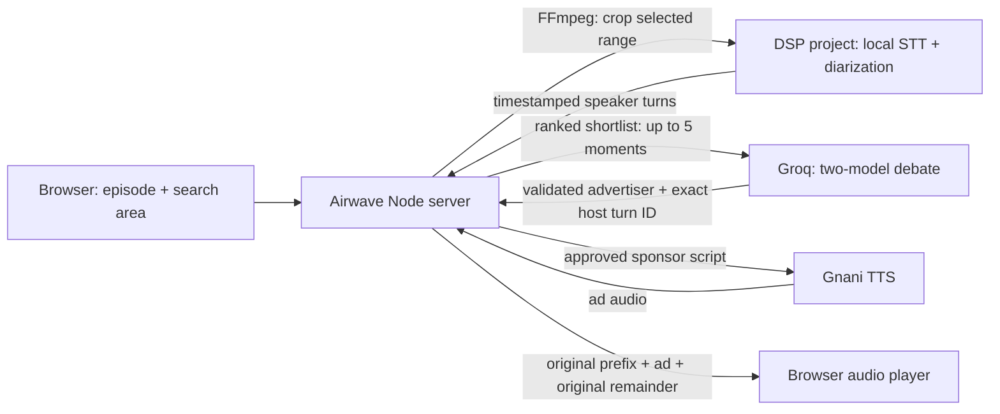

# How Airwave works

Airwave is a local-first podcast ad-insertion demo. A listener loads an episode, the local DSP project transcribes a selected range with speaker and word timing, two Groq models debate eligible sponsor placements, Gnani creates the spoken ad, and the local server streams the original episode with that ad inserted at a validated host turn end.

## At a glance

## 1. Load the episode and choose a search area

The browser accepts an episode file and a broad time range where an ad might fit. Airwave does not upload the full podcast to a cloud transcription provider. For local transcription, the browser sends the file to the Airwave Node server on the computer (`127.0.0.1:4175`). The server uses FFmpeg to crop only the chosen range and convert that crop to mono 16 kHz WAV.

The Airwave server then sends that crop to the DSP project's local recording service at `127.0.0.1:5095`. It creates a background upload job, so a long local scan can take time. Airwave polls the job status and fetches its completed transcript when ready.

## 2. What the DSP project contributes

The included [`dsp/`](dsp/) folder contains the Python speech-processing component used by Airwave. Its local recording service accepts an uploaded crop, queues processing, runs local speech recognition and speaker diarization, and exposes a transcript with timestamps and speaker turns. It is configured to listen on loopback port `5095`; it is not exposed as a public service.

Airwave calls the DSP service's local endpoints:

- `GET /api/upload-config` to check that the service is enabled.
- `POST /api/uploads` to submit the cropped WAV and receive a job ID.
- `GET /api/jobs/{jobId}` to poll progress.
- `GET /recordings/{jobId}/transcript.json` to fetch the completed transcript.

The transcript gives Airwave word/turn timing, speaker IDs, and uncertainty/overlap flags. The listener chooses which detected speaker is the host. Speaker IDs are estimates, so that choice still needs a human check.

The `dsp/` folder contains only source and setup files required by Airwave. Recordings, caches, virtual environments, and model binaries are excluded from Git. The DSP setup script downloads the model assets locally when needed.

## 3. Find candidate moments without sending the full transcript

Airwave first filters the local transcript to completed turns by the chosen host. It rejects turns that are uncertain, overlapped, outside the selected range, or lack enough adjacent context. A local ranker uses turn endings, conversational sequence, possible question-answer continuity, timing, and available silence evidence to order the candidates. It returns a short, time-separated shortlist of at most five moments.

Only that shortlist and nearby transcript context are sent to Groq. The request also contains the episode topic, listener interest tags and language, plus advertiser campaign facts and prohibited claims. The full episode audio never goes to Groq, and the full transcript is not sent as one prompt.

## 4. Let two models debate advertiser and moment

The two configured Groq models independently choose an advertiser, sponsor script, and exact eligible host-turn ID. The second model reviews both first-round proposals. Each model then gets the review of its proposal and can keep or revise its choice. The server validates the final proposals against the advertiser catalog and the eligible turn IDs, then scores relevance, safety, naturalness, and slot fit.

The server resolves a chosen turn ID to that host turn's actual `endSeconds`; it does not trust an LLM-invented timestamp. It also checks the selected speaker and range. If no candidate passes the safety/fit thresholds, or a live model request fails, Airwave does not insert a simulated ad.

## 5. Generate and preview the sponsor read

After a candidate is chosen for preview, Airwave sends its sponsor script and selected language to Gnani TTS. An optional cloned host voice can be used only after the speaker uploads a clean sample and checks the consent box. Gnani receives that sample to prepare the voice embedding; the server holds the embedding in memory and exposes a control to forget it.

FFmpeg prepares a short preview around the insertion point. The preview plays the original conversation leading up to the turn end, the clearly disclosed sponsor read, and the original episode continuing afterward.

## 6. Play the episode as one continuous stream

When the listener presses **Start full episode**, the browser plays a server stream made of:

1. The original episode from the beginning through the selected host turn's exact end.
2. The generated sponsor audio.
3. The rest of the original episode from that same point onward.

The original episode is retained, so no spoken content is cut out; the ad adds its duration to playback. The listener does not need to download a replacement MP3. Temporary source audio and stream sessions are held locally and expire/clean up after their session window.

## What this demo does and does not do

- It does use the local DSP project's STT and diarization service for timestamped speaker turns.
- It does use live Groq models when a Groq key is configured, and Gnani TTS when a Gnani key is configured.
- It inserts audio into a continuous player stream after an explicit review/preview step.
- It does **not** connect to Spotify or intercept Spotify playback. The listener uploads a local episode file and starts the stream in Airwave.
- It does **not** run an always-on background ad engine. Scanning, model review, preview generation, and full-stream playback are user-triggered steps.
- It does **not** guarantee a perfect conversational transition. Turn boundaries, transcripts, model judgments, and generated speech should be reviewed by listening.

## Local data and external services

The audio file and crop are processed by the local Airwave and DSP services. The browser caches transcript turns and the selected host speaker in IndexedDB; the local Airwave server also caches transcripts for reuse. Groq receives the small text shortlist described above. Gnani receives the generated sponsor text for TTS, and receives a voice sample only when optional voice cloning is explicitly requested. API keys are kept by the local server and are not embedded in the browser bundle.

See the [main README](README.md) for setup and run instructions, and [`dsp/README.md`](dsp/README.md) for DSP setup details.
