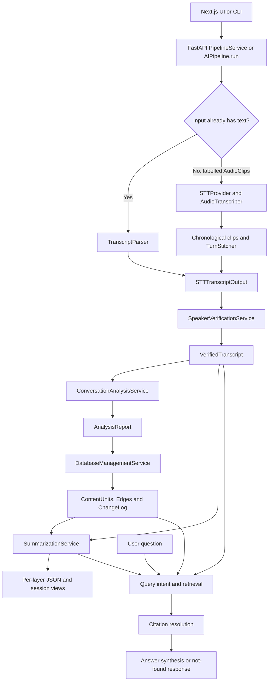

# AI layer: actual architecture and presentation guide

Reviewed on **6 October 2026** against GitHub branch **`AI_Layer`**, commit **`47550b74494d43163ffba2200bcc4a96557f38d7`**. This is a source-code review, not a claim that this branch's complete web stack was executed during this review.

Companion: [Complete minor-project explanation and presentation](../Presentation/01_Minor_Project_Complete_Explanation_and_Presentation.md).

### Reading routes

- For a quick explanation: sections 1–3.
- For implementation details: sections 4–8.
- For your presentation and questions: sections 9–10.
- For code evidence: section 11.

### Contents

- [What the AI layer does](#1-start-here-what-the-ai-layer-does)
- [Current code and branch differences](#2-which-code-is-current)
- [Architecture map](#3-architecture-map)
- [Shared contracts](#4-the-contracts-connecting-stages)
- [Stage-by-stage explanation](#5-stage-by-stage-explanation)
- [Backend, frontend, and artifacts](#6-backend-frontend-and-saved-artifacts)
- [Providers and testing](#7-providers-and-honest-offline-testing)
- [DSP integration plan](#8-how-the-dsp-branch-should-connect-to-this-architecture)
- [Three-minute presentation](#9-presenting-the-ai-layer-in-three-minutes)
- [Examiner questions](#10-questions-examiners-may-ask)
- [Pinned code evidence](#11-code-evidence-and-review-scope)

## 1. Start here: what the AI layer does

The DSP layer answers **“which voice was active at what time?”** The AI layer answers **“what was said, what matters, what should happen next, and where is the evidence?”**

There are five processing stages and a sixth, on-demand question-answering stage:

1. Convert speaker-labelled clips, or an existing transcript, into dialogue turns.
2. Resolve possible speaker names from conversation evidence and known profiles.
3. Extract facts, decisions, tasks, and speaker contribution profiles.
4. Organize those insights into knowledge records and relationships.
5. Generate a session summary and, when supplied with project context, a project summary.
6. Retrieve relevant records to answer questions with source references.

Presentation sentence:

> “Our AI layer converts a chronological conversation into structured, searchable meeting knowledge. Its outputs keep links to the speaker and original turn so a user can inspect the supporting evidence.”

Important qualification: an extracted “fact” means a claim found in the conversation, **not an independently verified real-world fact**. A citation makes an output inspectable; it does not automatically make it correct.

## 2. Which code is current?

The active implementation on this branch uses `src/ai_layer/pipeline.py` and its `AIPipeline` class. Do not describe `OLD_AI_Layer_implemenation/` as the active architecture. Older documentation also uses names such as `MainAnalyzerService`; the current conversation-analysis service is `ConversationAnalysisService`.

Our local `codex/dsp-audio-processing` branch has a different, older AI integration: `AILayerOrchestrator.process_dsp_payload()` and `AudioClipPayload`. The newest remote AI branch does **not** include that payload class or the DSP package. The two implementations must not be presented as already merged.

| Area | Latest `AI_Layer` branch | Current local DSP demo |
|---|---|---|
| Entry point | `AIPipeline.run()` / `execute()` | `DSPPipeline` → `AILayerOrchestrator.process_dsp_payload()` |
| Audio boundary | `list[AudioClip]` | `AudioClipPayload`, containing segments and provenance |
| Backend | FastAPI in `backend/app/` | Local server in `app.py` |
| Frontend | Next.js/React in `frontend/` | HTML/CSS/JavaScript in `web/` |
| Acoustic multi-speaker detection | Expects labelled clips; raw-file entry does not diarize | Real ONNX diarization implemented and locally tested |
| Knowledge store in web execution | New `MockDatabase` for each run; JSON session outputs | Separate local implementation; not the new branch's store |

This is an integration boundary, not a reason to replace either team's work wholesale.

## 3. Architecture map



Text fallback: **input → turns → speaker resolution → insights → knowledge → summaries**, with **question → retrieve → cite → answer** reading the resulting records.

The common envelope is `PipelineContext`. Each `PipelineStep.execute(context)` fills its own output field and returns the context. `AIPipeline` controls order, records durations and errors, and optionally stops after a named step. Query generation is skipped if no question was supplied; six configured steps do not mean six output files on every run.

### Actual package responsibilities

```text
src/ai_layer/
├── pipeline.py               Composition, step execution, metrics, output export
├── common/
│   ├── interfaces.py         STTProvider, LLMProvider, PipelineStep, DatabaseAdapter
│   ├── pipeline_context.py   Shared execution envelope
│   ├── config_loader.py      Typed YAML/environment configuration
│   ├── provider_factory.py   Provider selection
│   └── providers/            Mock, local and cloud adapters
├── models/                   Cross-stage dataclass contracts
├── transcription/            Clip sorting, STT, parsing, turn stitching
├── speaker_verification/     Name cues, identity resolution, confidence heuristics
├── conversation_analysis/    Insights, normalization, citations, speaker profiles
├── database_management/      Content units, matching, relationships, integration
├── database/                 In-memory MockDatabase and maintenance utilities
├── summarization/            Session and project summaries
└── query_answering/          Intent, retrieval, citations and answer synthesis

backend/app/                  HTTP schemas, routes and application services
frontend/                     React views, pipeline studio and audio playback UI
tests/                        Stage, pipeline, provider, CLI and API tests
```

Provider protocols make inference replaceable. However, several current orchestration/query classes still explicitly use `MockDatabase`, so database independence is an architectural direction, not fully achieved production decoupling.

## 4. The contracts connecting stages

| Contract | Important information | Why it matters |
|---|---|---|
| `AudioClip` | `clip_id`, `audio_path`, `preliminary_speaker_id`, `time_range` | A labelled audio slice with **session-relative** time |
| `RawTranscriptInput` | `session_id`, `raw_text`, `format_type` | Existing text bypasses speech recognition |
| `STTTranscriptOutput` | `session_id`, `turns`, `raw_utterances` | Canonical chronological conversation representation |
| `StitchedTurn` | `turn_id`, `speaker_id`, `text`, `time_range`, `source_utterance_ids` | Several clips can form one readable turn without losing their IDs |
| `VerifiedTranscript` | Resolved turns, cues, reassignments, unresolved speakers | Name-resolution results and uncertainty remain visible |
| `AnalysisReport` | Facts, decisions, action items, speaker profiles, metadata | Structured interpretation rather than a single paragraph |
| `UtteranceCitation` | Turn ID, speaker name, time range, spoken text | Links an insight back to a source turn |
| `KnowledgeUpdateResult` | New/updated units, new edges, change-log entries | Separates computing an update from applying it to a store |
| `SummarizationResult` | Session summary and optional project summary | Distinguishes one meeting from accumulated project status |
| `QueryAnswer` | Answer text, citations, confidence, `is_fallback`, metadata | Includes an explicit unsupported-question outcome |

`TimeRange` uses `start_time_seconds` and `end_time_seconds`. Do not reset a 42–48-second session clip to 0–6 seconds when sending it to AI: that would break evidence playback.

Domain models are mostly frozen dataclasses, not comprehensive Pydantic-validated inference results. HTTP request/response models use Pydantic. Type annotations and valid JSON alone do not guarantee semantic correctness.

## 5. Stage-by-stage explanation

### Stage 1 — Transcription and direct transcript ingestion

**Question:** What words were spoken, in what order?

Audio path:

```text
AudioClips → validate times → sort → transcribe each clip
           → RawUtterances → stitch neighbouring same-speaker utterances → turns
```

`AudioTranscriber` calls `STTProvider.transcribe_clip(audio_path, language)`. It returns words, while the clip carries its original time and speaker label. Its audio-hash cache is an instance-local dictionary, not a distributed or persistent cache. The batch implementation is sequential.

`TurnStitcher` merges consecutive utterances from the same speaker when their gap is at most the configured 1.5 seconds. Example: “We need…” and “…more testing” can appear as one turn, while preserving both source utterance IDs.

Text path: `TranscriptParser` accepts JSON, `[start - end] Speaker: text`, speaker-prefixed lines, or plain lines. It does **not** implement native VTT/SRT ingestion on this branch. Our DSP branch has a separate Meet parser, so a normalization adapter is needed.

Untimed text normally gets 0–0 time ranges rather than measured audio times. There is also a JSON edge case: when an explicit start exists without an end, the parser estimates duration even with general timestamp estimation disabled. Such times must be labelled estimated, not used as ground-truth playback alignment.

**Raw-audio limitation:** `AIPipeline.run(Path(...))` wraps a supported audio file into a single `AudioClip` labelled `SPEAKER_01` with a placeholder 0–3600-second interval. This is not acoustic diarization or duration measurement. Real multi-speaker input should arrive as DSP-generated clips with accurate intervals.

Say in presentation:

> “Speech recognition gives us words. Speaker-labelled DSP clips give those words their voice group and position in the original meeting. If we already have a transcript, we skip speech recognition.”

### Stage 2 — Speaker identity resolution

**Question:** Is there enough conversation evidence to associate an anonymous label with a name?

`IdentityCueExtractor` looks for self-introductions, direct addresses, and other contextual cues using an LLM, or optional heuristics. `IdentityResolver` compares cues with registered profiles. `SpeakerConfidenceScorer` produces confidence and profile updates. `VerifiedTurn` retains both the preliminary and resolved speaker IDs.

This is **text/context-based identity resolution**, not voiceprint authentication. “I am Sarah” is potential evidence; “Sarah, can you help?” is an address to someone else and is more ambiguous. Anonymous labels should remain anonymous when evidence is inadequate. Fixture profiles from `test_resources/registered_speakers.json` are not a real meeting's verified attendee directory.

Confidence scores are application/model heuristics, not calibrated probabilities that a person's identity is correct. Reassignments need review.

Say:

> “Diarization groups voices; it does not know names. This stage uses explicit conversation clues and known profiles to suggest names, while keeping unresolved speakers visible.”

### Stage 3 — Conversation analysis

**Question:** What did the participants report, decide, and commit to doing?

`ConversationAnalysisService` first attempts one unified LLM extraction of facts, decisions, and tasks. It then invokes individual extractors for categories that remain empty; optional heuristics can provide an offline fallback. Empty categories can also be legitimate—an informal discussion may contain no action items.

It builds typed objects, normalizes statements into self-contained sentences, and links citations. Speaker analytical profiles summarize contributions and include configurable importance metrics. These are discussion indicators, not an objective assessment of a person's value or authority.

Illustrative example, **not a measured run**:

| Spoken sentence | Interpretation |
|---|---|
| “The upload test currently fails.” | Reported technical fact/state |
| “We agree to use WAV for the first demo.” | Decision |
| “I will fix the upload test by Friday.” | Action, assignee if supported, deadline |
| “Maybe we could add live streaming.” | Proposal; not automatically a finalized decision |

**Citation limitation:** `CitationLinker.link_best_citation()` tries ID matching, then text overlap, then falls back to the first turn. It can also store the extracted statement as `spoken_text`, which need not be a verbatim quote. Thus “every citation is a verified quote” is currently an unsafe claim. A stronger next version should retain the exact source quote and return unresolved provenance instead of choosing an unrelated first turn.

Say:

> “We separate reported information, agreed decisions, and future work. Each extracted item carries a source link that we can inspect against the transcript.”

### Stage 4 — Knowledge integration

**Question:** Is this new information, confirmation, a replacement, or a contradiction?

The implementation builds `ContentUnit` records from analysis. Units carry type, content, workspace/project scope, status, and source IDs. `SimilarityMatcher` compares them with existing units. It can use an LLM similarity score and, when enabled, word-overlap heuristics. `MockDatabase.similarity_search()` uses lexical Jaccard overlap, **not an actual pgvector search**.

`RelationshipClassifier` and `KnowledgeIntegrator` support relationships such as reinforcement, supersession, contradiction, and elaboration. `KnowledgeUpdateResult` reports new/changed content, edges, and audit entries. The pipeline applies those updates to its store.

Example: “Demo is Tuesday” followed by “Move the demo to Thursday” should preserve the old source, mark the old plan superseded where supported, and link to the new plan. This is the intended knowledge-evolution behaviour; demonstrate it with a verified fixture rather than merely drawing an arrow.

**Persistence distinction:** `MockDatabase` is an in-memory store with optional JSON save/load methods. The FastAPI pipeline service constructs a fresh instance for each request and does not restore a shared knowledge checkpoint. Per-session JSON files persist on disk, but automatic cross-session memory in the web API is not established by that fact. Reusing one database in library calls supports a different execution pattern.

Say:

> “We keep knowledge as source-linked records, not just a growing text summary. The prototype models relationships between old and new information; persistent cross-session storage is a remaining integration step.”

### Stage 5 — Session and project summarization

**Question:** What happened in this meeting, and what does it change for the project?

`SessionSummarizer` uses the verified transcript and extracted analysis. `ProjectSummarizer` can update rolling status using the new session, previous summary, and recent context. A project summary requires `project_id` and the relevant historical context; supplying a project ID alone does not prove history was loaded.

Say:

> “The session summary describes this meeting. The project summary is designed to describe how the project stands across meetings, provided we supply the previous records.”

### Stage 6 — Retrieval-based question answering

**Question:** What do our conversation records say about the user's question?

```text
Question → intent/entities → candidate records → relevance ranking
         → optional graph neighbours → source citations → answer or fallback
```

`QueryIntentAnalyzer` identifies intent. `InMemoryRetriever` ranks transcript turns, facts, tasks, decisions, summaries, and available content units using lexical overlap, keyword matching, and intent/entity bonuses. `CitationResolver` builds evidence references. `AnswerSynthesizer` uses the available evidence and an LLM or optional fallback.

The configuration normally retrieves up to five candidates. This is retrieval-augmented generation in structure, but it is not currently a deployed embedding-vector database. An unsupported question should produce the configured “records do not contain this information” message. Test this behaviour; prompts alone do not guarantee that an LLM will comply.

The HTTP query route reconstructs context from a selected saved session. It does not load a persistent all-project knowledge database. Its reconstruction also omits some database-update fields, so do not claim complete cross-session graph querying from the current web route.

Say:

> “Instead of answering from general model knowledge, we first retrieve conversation evidence. The answer exposes supporting turns, or reports that the records do not contain the answer.”

## 6. Backend, frontend, and saved artifacts

| Interface | Purpose |
|---|---|
| `POST /api/pipeline/run` | Text, sample transcript, sample audio, or uploaded-file reference |
| `POST /api/pipeline/upload` | Multipart upload followed by synchronous execution |
| `GET /api/sessions` | Discover saved runs |
| `GET /api/sessions/{session_id}` | Load all saved layer outputs |
| `GET /api/sessions/{session_id}/layers/{layer_name}` | Inspect one layer |
| `POST /api/query` | Ask a question, optionally scoped to a saved session |
| `GET /api/audio/{filename}` | Serve available source audio |
| `GET /api/health`, `/api/config`, `/api/samples` | Health, configuration, and fixture discovery |
| `/api/docs` | FastAPI's interactive API documentation |

The pipeline returns success/error, session ID, timings, counts, and saved paths. It runs synchronously; the UI waiting for a response is not evidence of a production background-job system.

Output convention:

```text
pipeline_outputs/<session_id>/
    01_transcription.json
    02_speaker_verification.json
    03_conversation_analysis.json
    04_database_management.json
    05_summarization.json
    06_query_answering.json       # only when a query was executed and exported
    pipeline_summary.json        # metadata, counts, timings, files
```

`SessionService` reads these files for archive/detail views. Saving files is not automatic failed-step resume. The export happens after execution in the high-level `run()` path; a failure before export does not guarantee every completed stage was checkpointed.

Frontend roles in the inspected source:

- `PipelineStudioModal`: choose input/provider and run a pipeline.
- `WorkspaceView` / `TranscriptView`: inspect turns and speaker evidence.
- `AudioPlayerBar`: source-audio playback, including segment playback integration.
- `IntelligenceHub`: insights and questions.
- `SessionArchiveGrid`: prior sessions.
- `ConfigPage` / `EngineStatusView`: selected configuration and status.
- `InspectorDrawer`: inspect individual objects.

**Fresh-clone blocker:** the committed frontend imports `frontend/lib/api`, `types`, `demoData`, and `sessionUtils`, but no `frontend/lib/` files exist in the inspected Git tree. Source is therefore incomplete for a reproducible frontend build. This is a static missing-file finding, not a build result. Restore and commit these helpers before relying on this branch's UI.

The page also contains a demo-data fallback design. When those helpers are restored, an attractive screen may still represent fixture data rather than a completed backend run. Show the backend connection, fresh session ID, provider, and saved outputs during a live demonstration.

## 7. Providers and honest offline testing

The provider factory supports:

| Role | Implemented selections in source |
|---|---|
| LLM | Mock, Gemini, OpenAI, Groq, Ollama |
| STT | Mock, local Whisper/Faster-Whisper, OpenAI Whisper, Gemini audio, Groq Whisper, Deepgram |

The reviewed YAML selects **Gemini** for LLM and **local Whisper `base` on CUDA** for STT. These are the branch's settings, not a recommendation or verification that the model names, account quotas, or device are usable on a particular machine. Cloud adapters require credentials/connectivity. Local models require installed runtimes, model files, and suitable device settings.

For an offline contract demonstration, explicitly choose **mock LLM + mock STT**, or use a direct transcript and mock LLM. Do not call this a real recognition or semantic-accuracy test.

The latest branch's `MockLLMProvider` contains fixed fixture responses about people, a contract, a launch date, and a slide deck. These can appear even for unrelated input. They prove wiring, **not successful extraction from arbitrary audio**. The local DSP branch's grounded/extractive mock is different; do not conflate them.

Existing tests cover transcription, identity resolution, extraction, knowledge integration, summaries, query answering, providers, pipeline execution, API routes, CLI, and TUI. They were inspected, not rerun on this remote branch for this documentation task. The earlier local DSP test count must not be attributed to the latest AI branch.

### A useful AI-layer verification checklist

- [ ] Run mock unit tests in a clean copy of the actual `AI_Layer` commit.
- [ ] Restore missing frontend helpers and pass `npm run build`.
- [ ] Use an explicitly timestamped transcript and inspect all five processing outputs.
- [ ] Confirm task assignees/deadlines exist in the source, not only in fixture defaults.
- [ ] Check citations against exact transcript text; test invalid turn IDs.
- [ ] Ask an unrelated question and verify a not-found response.
- [ ] Repeat a run after restart and distinguish saved files from loaded knowledge.
- [ ] Test project history with an explicitly reused/restored database.
- [ ] Test an audio clip's session time against actual playback.
- [ ] Mark which provider produced every displayed result.

## 8. How the DSP branch should connect to this architecture

This is a **proposed integration plan**, not work implemented by these documents.

| Local DSP field | Latest AI field | Handling |
|---|---|---|
| `segment_id` | `AudioClip.clip_id` | Preserve stable ID |
| `clip_path` | `AudioClip.audio_path` | Verify file exists and is readable |
| `preliminary_speaker_id` | Same field | Preserve anonymous labels |
| `start_time`, `end_time` | `TimeRange` start/end seconds | Preserve session-relative time |
| `session_id` | Pipeline context/session argument | Same ID for all outputs |
| `source_type`, `speaker_source`, overlap, warnings | No equivalent clip fields | Extend canonical contracts or use a documented typed provenance envelope |
| Native Meet names/text/times | Direct transcript input or prefilled transcript context | Normalize Meet entries; preserve real versus estimated times |

Integration order:

1. Agree on one versioned shared contract; do not couple DSP domain algorithms to AI services.
2. Add an application-boundary adapter from DSP payload segments to the current AI `AudioClip` DTO.
3. Preserve provenance and overlap metadata, which would otherwise be lost.
4. Route complete native transcripts around STT; add an explicit precomputed-transcript entry path if needed. The current `TranscriptionStep` does not simply accept a prefilled `stt_transcript` without input.
5. Reject placeholder durations for real audio; measure and validate all clip intervals.
6. Test two voices, overlap, missing names, transcript-only input, silence, and missing clips with mocks first.
7. Run one real acoustic recording through the adapted **latest** AI pipeline and inspect words, labels, evidence, files, and query results.
8. Connect one UI/backend to that verified flow, then implement durable knowledge loading and production hardening.

Do not claim partial Meet transcripts are already gap-filled across both branches: native/fallback paths exist locally, but complete mixed native-plus-STT provenance and the newest AI handoff need a specific integration test.

## 9. Presenting the AI layer in three minutes

### Slide A — “From dialogue to useful information” — 60 seconds

Visual: three timestamped conversation bubbles → three cards: fact, decision, task.

Say:

> “The input is no longer an unlabelled sound file. It is a chronological conversation, with speaker labels and source times. We first resolve names when there is evidence. We then separate what someone reported, what the group agreed, and what someone committed to do. The same sentence should not become an invented task just because it mentions future work.”

Show a source turn beside its extracted item. Prefer a verified actual result; label an illustration as an illustration.

### Slide B — “Knowledge with a history” — 45 seconds

Visual: old plan → changed plan, connected by a labelled supersedes edge; small source labels below both.

Say:

> “A transcript is chronological, but project knowledge changes. We represent insights as content units and relationships, so a changed plan can be distinguished from reinforcement or contradiction. The current prototype has an in-memory store and saved session artifacts; durable cross-session integration is the next engineering step.”

### Slide C — “Ask, then verify” — 45 seconds

Visual: question → two retrieved evidence cards → answer + timestamps.

Say:

> “A question first goes through retrieval. The answer should use relevant conversation evidence and expose the supporting speaker and time range. If the answer is absent from the records, the correct behaviour is to say so. We inspect citations because a model-generated reference is not automatically valid.”

### Live proof — 30 seconds

Open a previously verified run, show its provider/session ID, one extracted item, its source turn, and one query response. If the UI has not passed the missing-file/build checks, use saved JSON or the API—not an unverified frontend screen.

One-sentence handoff from the DSP presenter:

> “DSP has now supplied speaker-labelled, timestamped clips. The AI layer will turn their words into inspectable insights and answers.”

## 10. Questions examiners may ask

**Is speaker verification biometric verification?** No. Here it is name resolution from transcript cues/profiles, not a verified voiceprint identity check.

**Did you train an LLM or Whisper?** No. We integrate pretrained providers and implement the contracts, orchestration, extraction workflow, provenance, and interface.

**Is this just one summarization prompt?** No. The code separates transcription, identity, typed insight extraction, knowledge updates, summaries, and question retrieval. Each has inspectable outputs and tests.

**Is pgvector running?** Not in the current AI web execution path. The schema anticipates embeddings; retrieval currently uses in-memory/lexical mechanisms.

**Can it remember earlier sessions?** The library can use existing context/reused storage, and files persist. The web service currently creates fresh memory; automatic durable cross-session loading is unfinished.

**Are confidence values probabilities?** No. They are model/application scores unless separately calibrated.

**Does a citation guarantee truth?** No. It allows inspection; current fallback linking also needs improvement.

**Does raw audio automatically get multiple speakers here?** Not in this branch's generic file entry. The DSP integration must supply accurately timed, labelled clips.

**Can the demo run without API keys?** Contract tests can use mocks. Genuine inference needs locally installed models or a configured external provider. Fixed mock output is not evidence of recognition quality.

## 11. Code evidence and review scope

All links below are pinned to the reviewed commit, so future branch edits do not silently change what this guide describes.

- [Pipeline and exports](https://github.com/PrithvirajSinghChauhan8444/Audio_File/blob/47550b74494d43163ffba2200bcc4a96557f38d7/src/ai_layer/pipeline.py)
- [PipelineContext](https://github.com/PrithvirajSinghChauhan8444/Audio_File/blob/47550b74494d43163ffba2200bcc4a96557f38d7/src/ai_layer/common/pipeline_context.py)
- [Provider/step/database interfaces](https://github.com/PrithvirajSinghChauhan8444/Audio_File/blob/47550b74494d43163ffba2200bcc4a96557f38d7/src/ai_layer/common/interfaces.py)
- [Transcription contracts](https://github.com/PrithvirajSinghChauhan8444/Audio_File/blob/47550b74494d43163ffba2200bcc4a96557f38d7/src/ai_layer/models/transcription_models.py)
- [Transcript parser](https://github.com/PrithvirajSinghChauhan8444/Audio_File/blob/47550b74494d43163ffba2200bcc4a96557f38d7/src/ai_layer/transcription/transcript_parser.py)
- [Speaker verification](https://github.com/PrithvirajSinghChauhan8444/Audio_File/blob/47550b74494d43163ffba2200bcc4a96557f38d7/src/ai_layer/speaker_verification/service.py)
- [Conversation analysis](https://github.com/PrithvirajSinghChauhan8444/Audio_File/blob/47550b74494d43163ffba2200bcc4a96557f38d7/src/ai_layer/conversation_analysis/service.py)
- [Citation matching and fallback](https://github.com/PrithvirajSinghChauhan8444/Audio_File/blob/47550b74494d43163ffba2200bcc4a96557f38d7/src/ai_layer/conversation_analysis/citation_linker.py)
- [Knowledge integration facade](https://github.com/PrithvirajSinghChauhan8444/Audio_File/blob/47550b74494d43163ffba2200bcc4a96557f38d7/src/ai_layer/database_management/service.py)
- [MockDatabase](https://github.com/PrithvirajSinghChauhan8444/Audio_File/blob/47550b74494d43163ffba2200bcc4a96557f38d7/src/ai_layer/database/mock_database.py)
- [Summarization](https://github.com/PrithvirajSinghChauhan8444/Audio_File/blob/47550b74494d43163ffba2200bcc4a96557f38d7/src/ai_layer/summarization/service.py)
- [Question-answering service](https://github.com/PrithvirajSinghChauhan8444/Audio_File/blob/47550b74494d43163ffba2200bcc4a96557f38d7/src/ai_layer/query_answering/service.py)
- [In-memory retrieval](https://github.com/PrithvirajSinghChauhan8444/Audio_File/blob/47550b74494d43163ffba2200bcc4a96557f38d7/src/ai_layer/query_answering/in_memory_retriever.py)
- [HTTP pipeline service and fresh store](https://github.com/PrithvirajSinghChauhan8444/Audio_File/blob/47550b74494d43163ffba2200bcc4a96557f38d7/backend/app/services/pipeline_service.py)
- [Session query reconstruction](https://github.com/PrithvirajSinghChauhan8444/Audio_File/blob/47550b74494d43163ffba2200bcc4a96557f38d7/backend/app/routers/query.py)
- [Frontend imports and demo-state design](https://github.com/PrithvirajSinghChauhan8444/Audio_File/blob/47550b74494d43163ffba2200bcc4a96557f38d7/frontend/app/page.tsx)
- [Actual provider configuration](https://github.com/PrithvirajSinghChauhan8444/Audio_File/blob/47550b74494d43163ffba2200bcc4a96557f38d7/configs/ai_layer_config.yaml)
- [Mock fixture behaviour](https://github.com/PrithvirajSinghChauhan8444/Audio_File/blob/47550b74494d43163ffba2200bcc4a96557f38d7/src/ai_layer/common/providers/mock_llm_provider.py)

The Nemotron integration guide is documentation, not proof of a connected Nemotron provider. Historical planning documents and committed output files were not treated as substitutes for inspecting the active code. This task adds documentation only; it does not fix the implementation gaps identified above.
