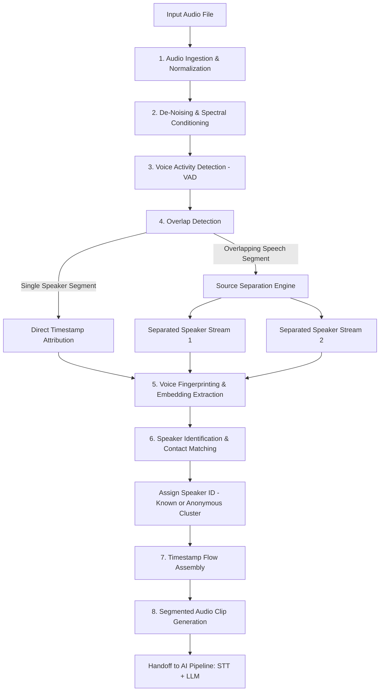
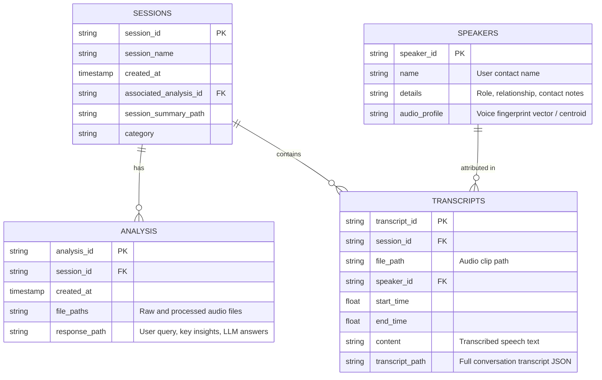

# DSP & Speech Processing: Multi-Speaker Separation and Identification
*System Architecture & Technical Specification — Aligned with [Initial plan.md](file:///home/prit/Project_Linux/Audio_File/Documentation/Initial%20plan.md)*

---

## 1. Executive Summary & Purpose

This document defines the technical architecture, algorithms, and integration contracts for the **Audio & Speech Processing Layer** of the platform.

As established in the **[Initial plan.md](file:///home/prit/Project_Linux/Audio_File/Documentation/Initial%20plan.md)** (the source of truth), the overall platform is:
> *"A platform that combines speech processing with AI to manage your personal and professional life."*

The role of this layer is **not** an isolated academic exercise in raw signal separation. Instead, it serves as the **front-end perceptual engine** that ingests raw conversation audio (single or multiple overlapping speakers), cleans it, separates overlapping speech, determines *who spoke when* with unique speaker IDs and timestamps, and produces clean segmented audio clips ready for the downstream **AI Pipeline (STT + LLM)** and **Relational Database**.

```text
┌─────────────────────────────────────────────────────────────────────────────┐
│                             Raw Audio File                                  │
│             (Conversations with Single or 2+ Overlapping Speakers)           │
└──────────────────────────────────────┬──────────────────────────────────────┘
                                       │
                                       ▼
┌─────────────────────────────────────────────────────────────────────────────┐
│                 Audio & Speech Processing Layer (This Document)             │
│  ├─ 1. Preprocessing & De-Noising                                           │
│  ├─ 2. Multi-Speaker Diarization & Timestamp Flow Mapping                   │
│  ├─ 3. Overlap Detection & Source Separation                                │
│  ├─ 4. Voice Fingerprinting & Speaker Identification (Contacts Matching)    │
│  └─ 5. Audio Clip Slicing & Metadata Packaging                              │
└──────────────────────────────────────┬──────────────────────────────────────┘
                                       │ [Clips + Timestamps + Speaker IDs]
                                       ▼
┌─────────────────────────────────────────────────────────────────────────────┐
│                                AI Pipeline                                  │
│  ├─ Speech-to-Text (STT) Transcription                                      │
│  ├─ LLM Conversation Analysis & Insights                                    │
│  ├─ Identity Verification (Cross-referencing acoustic ID with chat context) │
│  └─ User Query Answering                                                    │
└──────────────────────────────────────┬──────────────────────────────────────┘
                                       │
                                       ▼
┌─────────────────────────────────────────────────────────────────────────────┐
│                       Relational Database Knowledge Base                    │
│           [Sessions] ── [Analysis] ── [Transcript] ── [Speakers]            │
└─────────────────────────────────────────────────────────────────────────────┘
```

---

## 2. Key Differences from the Previous DSP Guide

The original document (`DSP_Multi_Speaker_Separation.md`) diverged from the platform's vision in several fundamental ways:

| Feature / Dimension | Previous `DSP_Multi_Speaker_Separation.md` | Corrected Specification (Aligned with Initial Plan) |
| :--- | :--- | :--- |
| **Primary Objective** | Academic DSP demonstration to satisfy college presentation requirements. | Production front-end speech engine for a personal/professional AI assistant platform. |
| **End-to-End Scope** | Terminates at cosine similarity speaker matching; zero awareness of downstream systems. | Full integration into **AI Pipeline (STT + LLM)** and the **Relational Database Knowledge Base**. |
| **Chronological Diarization** | Completely missing; assumed static synthetic mixtures separated into two continuous audio tracks. | **Mandatory timestamp flow**: extracts chronological segments, mapping start/end times per speaker ID. |
| **Downstream Handoff** | Outputs raw separated WAV files with no transcript or structured metadata. | Generates segmented audio clips tied to speaker IDs, timestamps, and file paths for STT transcription. |
| **Speaker Identification** | Isolated folder of WAV files matching raw MFCC vectors. | Relational **`Speakers` Table** (acting as contacts with metadata, history, and audio profiles) with LLM verification. |
| **Technological Approach** | Relies on classical single-channel NMF as primary; postpones deep learning to an optional phase. | **Pragmatic hybrid approach**: classical DSP for conditioning/VAD + modern separation/embedding models to ensure high STT accuracy. |
| **Target Audience & Tone** | Professor viva/presentation questions, grading rubrics, PPT outlines. | Software and system engineering architecture document. |

---

## 3. Detailed Speech Processing Pipeline (Layer 1)

In [Initial plan.md](file:///home/prit/Project_Linux/Audio_File/Documentation/Initial%20plan.md), this layer is designated under the section header *"Voice Synthesis"* (describing audio enhancement, diarization, separation, and speaker assignment):
1. De-Noise the audio file.
2. Analyze the audio to extract multiple speakers.
3. Try to mark different speakers using an unique ID.
4. Create a timestamp flow of the audio with speaker ID.
5. Separate these timestamps with the speaker ID (Single file, allow multiple IDs), considering multiple people speaking at the same time.

Below is the step-by-step technical implementation of this flow:



### 3.1 Step 1: Audio Ingestion & Normalization
- **Supported Inputs**: WAV, MP3, M4A, FLAC from local recording, meeting imports, or microphone capture.
- **Resampling**: Standardize all incoming streams to **16 kHz, 16-bit Mono PCM** (the optimal rate for both acoustic speech processing and state-of-the-art STT models like Whisper).
- **DC Offset Removal & Peak Normalization**:
  $$\tilde{x}[n] = \frac{x[n] - \mu_x}{\max(|x[n]|) + \epsilon}$$
  Ensures consistent energy levels across recordings with varied microphone gains.

### 3.2 Step 2: De-Noising & Speech Enhancement
Raw meeting recordings suffer from air conditioner hum, background chatter, electrical hum, and room reverberation.
- **DSP Filtering**: High-pass filtering ($f_c \approx 80\text{ Hz}$) to eliminate sub-audible low-frequency rumble.
- **Noise Reduction**:
  - *Baseline DSP*: Stationary spectral gating / Wiener filtering to attenuate steady-state background noise.
  - *Advanced Speech Enhancement*: Deep learning-based real-time noise suppression (e.g., DeepFilterNet or RNNoise) that removes non-stationary transient noises (keyboard clicks, chair squeaks) without compromising speech intelligibility or stripping phoneme formants.

### 3.3 Step 3: Voice Activity Detection (VAD) & Overlap Detection
- **VAD**: Scans the conditioned audio stream to segment active speech frames from pauses and silence (e.g., Silero VAD or energy/zero-crossing thresholds).
- **Overlap Detection**: Analyzes time-frequency spectral characteristics to flag intervals where two or more voices are active simultaneously ($t_{\text{start}}$ to $t_{\text{end}}$). Overlapping speech is common in natural conversations and degrades standard STT if not separated.

### 3.4 Step 4: Multi-Speaker Source Separation
For intervals identified as overlapping speech:
- **Classical DSP Limitation**: While classical single-channel NMF (Non-Negative Matrix Factorization) is theoretically useful for decomposing spectrograms, it struggles to assign overlapping harmonic bases to specific speakers without strong speaker priors, leading to cross-talk and phase distortion that ruins STT transcription.
- **Production Architecture**:
  - If single-channel audio: Utilize a time-domain or time-frequency neural separation model (e.g., Conv-TasNet, SepFormer, or FastSep) to unmix overlapping segments into distinct, clean streams ($s_1[n], s_2[n]$).
  - If multi-microphone hardware is available: Leverage spatial beamforming (Delay-and-Sum or MVDR) and Independent Component Analysis (ICA) to exploit spatial separation.
- **Output**: Cleaned, unmixed speech audio corresponding to each active speaker during the collision window.

### 3.5 Step 5: Voice Fingerprinting & Speaker Identification
Once individual voice segments are isolated:
- **Feature Extraction**:
  - *Baseline*: Mel-Frequency Cepstral Coefficients (MFCCs: 13–39 dimensions) capturing spectral envelope and vocal tract characteristics.
  - *Robust Embeddings*: Pretrained deep speaker embeddings (e.g., ECAPA-TDNN or ResNet d-vectors) yielding a fixed 192/512-dimensional voice fingerprint robust to channel variations.
- **Speaker Matching**:
  - Calculate Cosine Similarity against known centroids in the **`Speakers` Database**:
    $$\text{Similarity}(\mathbf{e}_{\text{unknown}}, \mathbf{e}_{\text{speaker}}) = \frac{\mathbf{e}_{\text{unknown}} \cdot \mathbf{e}_{\text{speaker}}}{\|\mathbf{e}_{\text{unknown}}\| \|\mathbf{e}_{\text{speaker}}\|}$$
  - If $\text{Similarity} \ge \tau_{\text{threshold}}$: Assign existing `speaker_id` (e.g., `SPK_ALICE`).
  - If $\text{Similarity} < \tau_{\text{threshold}}$: Register a new provisional anonymous cluster (e.g., `SPK_UNKNOWN_01`), prompting user or LLM identity verification.

### 3.6 Step 6: Timestamp Flow Assembly & Audio Clip Generation
As mandated in `Initial plan.md`:
> *"4. Create a timestamp flow of the audio with speaker id.*
> *5. Separate these timestamps with the speaker id (Single file, allow multiple ids)."*

- **Timestamp Flow Structure**: An ordered timeline tracking all conversation turns:
  ```json
  [
    {
      "segment_id": "seg_001",
      "speaker_id": "SPK_RAJ",
      "start_time": 0.00,
      "end_time": 4.35,
      "is_overlap": false,
      "clip_path": "storage/sessions/sess_101/clips/seg_001.wav"
    },
    {
      "segment_id": "seg_002",
      "speaker_id": "SPK_PRIYA",
      "start_time": 3.80,
      "end_time": 7.10,
      "is_overlap": true,
      "clip_path": "storage/sessions/sess_101/clips/seg_002_sep.wav"
    }
  ]
  ```
- **Clip Slicing**: Slices the physical audio into discrete WAV clips stored in the session cache, allowing downstream parallel processing by the STT model.

---

## 4. Downstream AI Pipeline Integration (Layer 2)

The output of the Speech Processing layer directly seeds the **AI Pipeline**:

```text
Segmented Audio Clips + Speaker IDs + Timestamps
                       │
                       ▼
         ┌───────────────────────────┐
         │     STT Model Ingestion   │
         │ (Whisper / Faster-Whisper)│
         └─────────────┬─────────────┘
                       │
                       ▼
┌─────────────────────────────────────────────────────────────┐
│                    Structured Transcript                    │
│  - Speaker ID: SPK_RAJ                                      │
│  - Timestamp: [00:00 - 00:04.35]                            │
│  - Content: "Let's review the Q3 system metrics."           │
│  - Clip Path: storage/.../seg_001.wav                       │
└──────────────────────────────┬──────────────────────────────┘
                               │
                               ▼
         ┌───────────────────────────┐
         │     LLM Intelligence      │
         │  ├─ Conversation Analysis │
         │  ├─ Identity Verification │
         │  ├─ Knowledge Extraction  │
         │  └─ User Query Answering  │
         └───────────────────────────┘
```

1. **Speech-to-Text (STT)**:
   - Each separated clip is transcribed. Because audio clips are single-speaker and de-noised, word error rates (WER) are drastically reduced.
   - Generates a full chronological conversation transcript tagged with:
     - `speaker_id`
     - `content` (transcribed text)
     - `timestamps` (`start_time`, `end_time`)
     - `clip_path`
2. **LLM Conversation Analysis**:
   - Analyzes meeting dynamics, extracts action items, key decisions, and summaries.
3. **Verify Identification**:
   - The LLM validates or corrects speaker identities using semantic conversation context.
   - *Example*: If acoustic similarity was borderline between Bob and Charlie, but Speaker 1 says *"Thanks for calling me Bob,"* the LLM verifies and updates the identity confidence in the database.
4. **User Query Answering**:
   - Enables semantic search and Q&A over past conversations (e.g., *"What deadlines did Raj commit to last Tuesday?"*).

---

## 5. Database Schema Integration (Layer 3)

The audio processing layer interacts directly with the relational database defined in `Initial plan.md`.



### Table Specifications:
- **`Speakers`**: Functions like an intelligent contact book. Stores registered voice fingerprints, allowing users to filter conversations by specific people.
- **`Transcripts`**: Stores structured conversation turns with exact timestamps, speaker IDs, and clip references so audio can be replayed instantly without reprocessing.
- **`Sessions`**: Encapsulates a recorded meeting or conversation session.
- **`Analysis`**: Stores AI-generated insights, summaries, and user Q&A interactions.

---

## 6. Technical Recommendations & Pragmatic Development Roadmap

To bridge the DSP foundation with the platform goals, implementation should follow these practical stages:

```
Phase 1: Audio Conditioning & Preprocessing (WAV standardization, VAD, De-Noising)
   │
Phase 2: Speaker Fingerprinting & Contacts DB (Embedding extraction, Cosine similarity, `Speakers` table)
   │
Phase 3: Diarization & Timestamp Flow (Single-speaker segmentation, turn-taking timeline)
   │
Phase 4: Overlap Separation Engine (Handling collisions, evaluating STT intelligibility)
   │
Phase 5: End-to-End AI Handoff (STT transcription per clip, LLM transcript analysis, Session DB storage)
```

### Metrics for Success:
- **Separation Quality**: SI-SDR (Scale-Invariant Signal-to-Distortion Ratio) $> 10\text{ dB}$ on overlapping speech.
- **Diarization Error Rate (DER)**: $< 8\%$ on clean recordings, $< 15\%$ on noisy multi-party meetings.
- **Downstream STT Accuracy**: Word Error Rate (WER) $< 12\%$ on separated speaker streams.
- **Speaker Recognition Accuracy**: $> 95\%$ on registered speakers with $\ge 15$ seconds of reference audio.

---

## 7. Ambiguities & Open Design Decisions for User Review

1. **Module Terminology**:
   In `Initial plan.md`, Tier 1 was titled *"Voice Synthesis"*, but its functional steps specify de-noising, speaker diarization, source separation, and timestamp extraction. We recommend formally standardizing this layer's name as **"Audio & Speech Processing"** to avoid confusion with text-to-speech (TTS) synthesis.
2. **Separation Algorithm Strategy**:
   The legacy DSP guide emphasized classical single-channel NMF. However, NMF on single-microphone mixed speech causes significant distortion that degrades Whisper/STT accuracy. We recommend a **hybrid architecture**: classical DSP for bandpass filtering, DC removal, and energy normalization, combined with a neural separation/diarization model (e.g. Silero VAD + PyAnnote / SepFormer) for high-accuracy timestamped segmentation.
3. **Hardware & Microphone Setup**:
   Is the immediate implementation focused on **pre-recorded single-channel audio files** (meetings, voice notes, uploads) or a **live multi-microphone array** (Raspberry Pi / USB mic array)? Pre-recorded single-channel files are the best starting point for personal & professional life management.
4. **Database Fields (`Author` & `Category`)**:
   `Initial plan.md` noted uncertainty regarding `Author` and `Category` in the `Sessions` table. We recommend retaining `Category` (e.g., `Meeting`, `Personal Note`, `Interview`, `Lecture`) and replacing `Author` with `Owner_User_Id` / `Created_By` to support multi-user workspaces.
