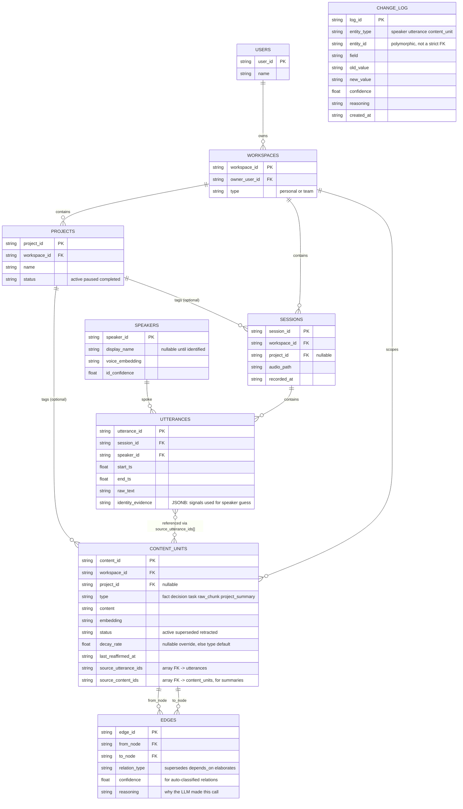
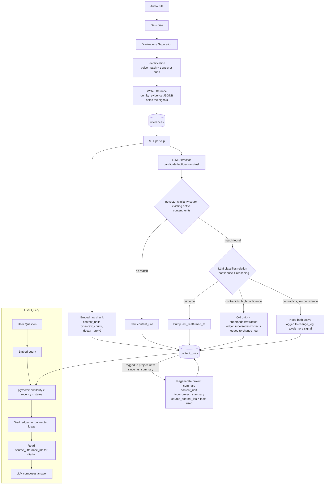

# v3 — Complete System Documentation

One file: the schema diagram, the flow diagram, what every table/field is for, how it all
connects, and how pgvector powers retrieval.

---

## 1. Schema Diagram

---

## 2. Flow Diagram

---

## 3. What Each Table Is, Field by Field

### `users`
The account holder.

| Field | Type | Purpose |
|---|---|---|
| `user_id` | UUID (PK) | Unique identifier. |
| `name` | string | Display name. |

**Connects to:** `workspaces` (owns).

### `workspaces`
The isolation boundary between personal life and a specific team — nearly every other
table inherits `workspace_id` as its scoping key.

| Field | Type | Purpose |
|---|---|---|
| `workspace_id` | UUID (PK) | Unique identifier. |
| `owner_user_id` | UUID (FK → `users`) | Who owns this workspace. |
| `type` | enum (`personal` / `team`) | Keeps private life-context and shared team-context from ever blending in a query. |

**Connects to:** `users` (owner), `projects`, `sessions`, `content_units` (all scoped
here).

### `projects`
A named grouping of related work within a workspace.

| Field | Type | Purpose |
|---|---|---|
| `project_id` | UUID (PK) | Unique identifier. |
| `workspace_id` | UUID (FK → `workspaces`) | Which workspace this belongs to. |
| `name` | string | Human-readable name. |
| `status` | enum (`active` / `paused` / `completed`) | Lifecycle state. |

**Why it exists:** a workspace usually holds multiple concurrent efforts; without this,
"what's the status of X" has no natural scope.

**Connects to:** `workspaces` (belongs to), `sessions` and `content_units` (optionally
tagged).

### `speakers`
A recognized voice, persistent across sessions and workspaces (one identity, never reset).

| Field | Type | Purpose |
|---|---|---|
| `speaker_id` | UUID (PK) | Unique identifier. |
| `display_name` | string, nullable | Known name, once identified. |
| `voice_embedding` | vector | Fingerprint for re-recognition. |
| `id_confidence` | float | Running confidence in the current identification. |

**Why voice alone isn't the whole story:** fingerprinting degrades with noise/illness and
can't cold-start identify someone new — identity is resolved from multiple signals (voice
+ transcript cues), logged per-utterance in `identity_evidence`, not just here.

**Connects to:** `utterances` (spoke), `change_log` (audit trail when a guess was wrong
and got corrected).

### `sessions`
One audio recording.

| Field | Type | Purpose |
|---|---|---|
| `session_id` | UUID (PK) | Unique identifier. |
| `workspace_id` | UUID (FK → `workspaces`) | Owning workspace. |
| `project_id` | UUID, nullable (FK → `projects`) | Optional project tag. |
| `audio_path` | string | Source audio location. |
| `recorded_at` | timestamp | When it happened. |

**Connects to:** `workspaces`, `projects`, `utterances` (contains).

### `utterances`
One segment of speech — the ground-truth layer everything else traces back to.

| Field | Type | Purpose |
|---|---|---|
| `utterance_id` | UUID (PK) | Unique identifier. |
| `session_id` | UUID (FK → `sessions`) | Source recording. |
| `speaker_id` | UUID (FK → `speakers`) | Who said it. |
| `start_ts` / `end_ts` | float | Position within the audio. |
| `raw_text` | string | STT output. |
| `identity_evidence` | JSONB | Array of signals behind the `speaker_id` guess, e.g. `[{signal_type, evidence, confidence}]` — read occasionally for debugging, not joined against constantly, hence JSON on the row instead of its own table. |

**Connects to:** `sessions`, `speakers`, `content_units` (cited via
`source_utterance_ids[]`, in the reverse direction).

### `content_units`
The single table for every extracted or derived piece of text — facts, decisions, tasks,
raw transcript chunks, and project summaries — distinguished by `type`. This is the core
table of the whole system.

| Field | Type | Purpose |
|---|---|---|
| `content_id` | UUID (PK) | Unique identifier. |
| `workspace_id` | UUID (FK → `workspaces`) | Isolation scope. |
| `project_id` | UUID, nullable (FK → `projects`) | Optional project tag. |
| `type` | enum (`fact` / `decision` / `task` / `raw_chunk` / `project_summary`) | What kind of content this row holds — one table doing the job of three, via this discriminator. |
| `content` | text | LLM-distilled fact text, or narrative text for a summary. |
| `embedding` | vector | Used by pgvector for similarity search. |
| `status` | enum (`active` / `superseded` / `retracted`) | `active` = valid now. `superseded` = was true, situation changed (stays lightly visible). `retracted` = was simply wrong (hidden from normal retrieval). |
| `decay_rate` | float, nullable | Recency-decay speed. `raw_chunk` = `0` (never penalized for age). Null elsewhere = use the type's default (app config, not a table). |
| `last_reaffirmed_at` | timestamp | Bumped whenever this idea is mentioned again — feeds the recency-weight at query time. |
| `source_utterance_ids` | UUID[] | Provenance — which utterances this was extracted from. |
| `source_content_ids` | UUID[] | For `project_summary` rows: which facts/decisions it was synthesized from. |

**Why arrays instead of a join table for provenance:** at this scale, an array + GIN index
answers provenance lookups as well as a join table would, without a table whose only job is
two foreign keys. **Tradeoff:** no referential-integrity cascade — cleanup on delete is the
application's job.

**Connects to:** `workspaces`, `projects`, `utterances` (via source array), other
`content_units` (via source array and via `edges`).

### `edges`
A relationship between two `content_units` — this is what makes retrieval relational
instead of pure similarity search.

| Field | Type | Purpose |
|---|---|---|
| `edge_id` | UUID (PK) | Unique identifier. |
| `from_node` / `to_node` | UUID (FK → `content_units`) | The two connected rows. |
| `relation_type` | string | E.g. `supersedes`, `corrects`, `depends_on`, `elaborates`. Open vocabulary — LLM reuses existing types where they fit, coins new ones only when genuinely distinct. |
| `confidence` | float | Confidence in this classification — gates whether a resulting status change applies immediately or waits. |
| `reasoning` | text | Why the LLM made this call — makes low-confidence or surprising edges auditable. |

**Connects to:** `content_units` (both ends).

### `change_log`
A generic audit trail for any auto-decided change — one table instead of a bespoke table
per feature (covers speaker relabeling and contradiction decisions alike).

| Field | Type | Purpose |
|---|---|---|
| `log_id` | UUID (PK) | Unique identifier. |
| `entity_type` | string | E.g. `speaker`, `content_unit`. |
| `entity_id` | UUID | The changed row's id — **polymorphic, not a strict FK**; consistency is the application's responsibility, not the database's. |
| `field` | string | Which field changed. |
| `old_value` / `new_value` | string | Before and after. |
| `confidence` | float | Confidence behind the automatic change. |
| `reasoning` | text | Why it happened. |
| `created_at` | timestamp | When. |

**Connects to:** `speakers` and `content_units` logically, not via enforced foreign key.

---

## 4. The Complete Flow, Explained

### Stage A — Ingestion (audio → structured knowledge)

1. An audio file arrives as a `session` (scoped to a `workspace`, optionally a `project`).
2. **De-noise**, then **diarize/separate** speakers within the file.
3. **Identification**: for each speech segment, gather evidence — voice-embedding
   similarity against known `speakers`, plus transcript cues (self-introduction, being
   addressed by name). This evidence is written to `utterances.identity_evidence`, and
   `speaker_id` is resolved as a best guess even at low confidence (correction happens
   later if wrong, logged to `change_log`).
4. **STT** produces `utterances.raw_text` for each segment.
5. Two things happen per utterance in parallel:
   - It's embedded as a `content_units` row of `type='raw_chunk'`, `decay_rate=0` — the
     verbatim safety net for "what did we literally say."
   - It's passed to LLM extraction, which proposes candidate facts/decisions/tasks.
6. Each candidate is checked with a **pgvector similarity search** against existing active
   `content_units` in the same workspace/project:
   - No close match → **new `content_unit`**.
   - Close match found → the LLM classifies the relationship: **reinforce** (bump
     `last_reaffirmed_at` on the existing row), or **contradicts** — split further into
     high-confidence (old row's `status` flips to `superseded`/`retracted`, a new `edge` is
     created, logged to `change_log`) or low-confidence (both rows stay `active`, logged,
     held pending more signal — this caps the damage of a wrong auto-classification).
7. If any `content_units` from this session are tagged to a `project`, that project's
   `project_summary` `content_unit` is regenerated, citing the facts it drew from via
   `source_content_ids`.

### Stage B — Query (question → answer)

1. The user asks a question, scoped to the workspaces/projects they have access to.
2. The question is embedded.
3. **pgvector similarity search** over `content_units.embedding` returns candidates by raw
   cosine similarity; this is then combined with `recency_weight` (from `decay_rate` +
   `last_reaffirmed_at`) and `status_weight` (active=1.0, superseded=capped low,
   retracted=~0) to produce the final ranking — pgvector handles the nearest-neighbor pass,
   the recency/status math re-ranks a smaller candidate set on top of it.
4. For the top-ranked `content_units`, **walk `edges`** to pull in connected ideas — what
   this supersedes, depends on, or elaborates.
5. **Pull `source_utterance_ids`** for citation, so the answer can point back to the actual
   moment it was said.
6. If a `project_summary` is the more direct answer (e.g. "what's the status of X"), it's
   often retrieved directly rather than requiring the LLM to re-synthesize from raw facts.
7. The LLM composes the final answer from the retrieved `content_units`, their edges, and
   their sources.

### Why pgvector specifically, and where it lives

pgvector is a Postgres extension adding a `vector` column type and distance operators, so
similarity search happens inside the same database as everything else — no separate vector
database, no cross-database syncing. In this schema it lives on exactly two columns:
`content_units.embedding` and `speakers.voice_embedding` (different embedding spaces,
never compared to each other).

**Index:** HNSW over IVFFlat — this system is under constant incremental write load (new
facts every session), and HNSW doesn't need periodic re-training as data grows the way
IVFFlat's clusters do.

**Distance operator:** cosine (`<=>`) — standard for text embeddings, where direction
matters more than magnitude.

**Why scoring isn't purely inside the vector index:** the final ranking needs similarity
multiplied by recency and status factors that pgvector's index doesn't know about. In
practice: let HNSW return an approximate top-N by raw similarity first, then apply the
recency/status multiplier and re-rank that smaller set — cheap to re-rank a few dozen rows,
expensive to run full decay math against the whole table every query.

**Two things worth revisiting before scale:**
- Workspace-filtered vector search can under-return results if the filter is applied after
  a small top-k pull rather than before/alongside it — worth a partial-index or over-fetch
  strategy once individual workspaces grow large.
- Embedding model changes make old and new vectors incomparable — either version-tag rows
  (`embedding_model_version`) or plan for a one-time re-embed batch job, since the
  underlying `content` text is always retained and embeddings are cheap to regenerate from
  it.
