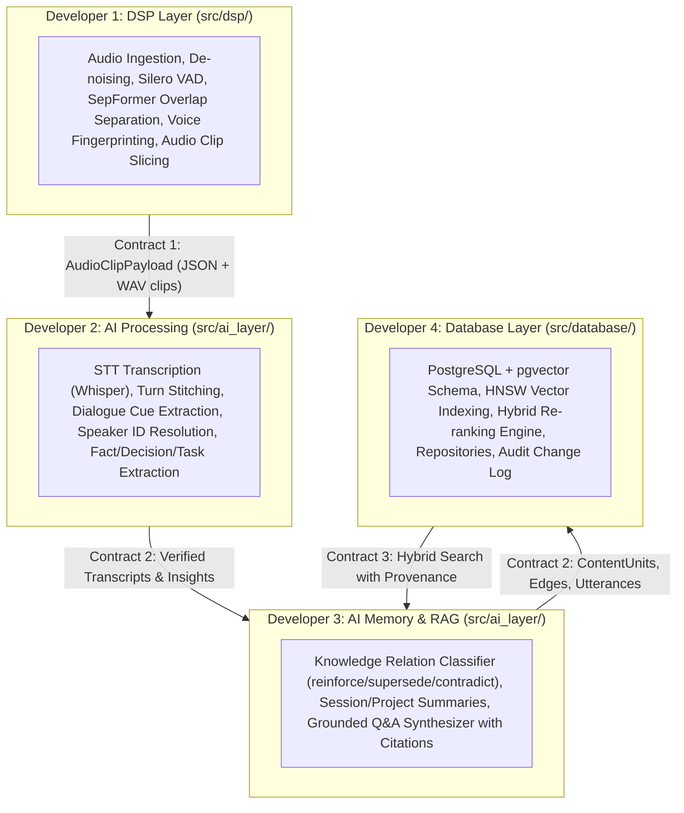

# Decoupled Multi-Layer Implementation Guide

This guide is the complete technical reference for developers working on the Voice & Meeting Intelligence Platform. It details the project-specific layer responsibilities, inter-layer data contracts, directory structures, step-by-step implementation orders, and mock-based testing workflows.

---

## 1. System Architecture & Work Division

The project is split into four distinct scopes for parallel development:



| Layer / Role | Primary Responsibilities | Input | Output | Tech Stack |
| :--- | :--- | :--- | :--- | :--- |
| **Developer 1 (DSP)** | Ingestion, filtering, VAD, overlap separation, voice embeddings, audio slicing | Raw Audio File (`.wav`, `.mp3`, `.m4a`) | `AudioClipPayload` JSON + directory of sliced `.wav` clips | PyTorch, Torchaudio, Silero VAD, SepFormer, ECAPA-TDNN, Librosa, SoundFile |
| **Developer 2 (AI Processing)** | STT transcription, dialogue cue verification, fact / decision / task extraction | `AudioClipPayload` + Audio Clips (or direct transcript text) | `VerifiedTranscript`, `AnalysisReport` | OpenAI API / Gemini SDK, Faster-Whisper, Pydantic / Dataclasses |
| **Developer 3 (AI Memory & RAG)** | Graph relation classification (`supersedes`, `reinforces`), project rollups, grounded Q&A | `AnalysisReport` + Database Query Results | `MemoryGraphUpdates`, `ProjectSummary`, `QueryAnswer` with citations | LLM Providers, Python protocols, Vector RAG |
| **Developer 4 (Database & Search)** | Relational storage, pgvector HNSW indexing, graph edge traversal, hybrid ranking | `Session`, `Utterances`, `ContentUnits`, `Edges` | Hybrid vector search results with provenance citations | PostgreSQL 16+, `pgvector`, SQLAlchemy / Asyncpg / Psycopg3 |

---

## 2. Git Branching & Isolated Development Workflow

To ensure zero merge collisions and complete independence, **each developer MUST work exclusively in their own dedicated Git branch** until their layer is fully implemented and tested.

```text
main (Clean Baseline)
 ├── feature/layer1-dsp            (Developer 1: DSP Engine)
 ├── feature/layer2a-ai-processing (Developer 2: STT & Extraction)
 ├── feature/layer2b-ai-memory-rag (Developer 3: Memory Graph & RAG)
 └── feature/layer3-database       (Developer 4: PostgreSQL + pgvector)
```

### 2.1 Branch Setup Commands
Before writing any code, each developer must create and checkout their assigned branch:

```bash
# Developer 1 (DSP)
git checkout -b feature/layer1-dsp

# Developer 2 (AI Processing)
git checkout -b feature/layer2a-ai-processing

# Developer 3 (AI Memory & RAG)
git checkout -b feature/layer2b-ai-memory-rag

# Developer 4 (Database & Search)
git checkout -b feature/layer3-database
```

### 2.2 Branch Development Rules
1. **Work Exclusively Within Your Branch**: Do not push directly to `main` during development.
2. **Do Not Block on Other Branches**: Implement mock adapters for any input data or downstream dependencies you need.
3. **Branch Completion Gate**: A branch is considered complete only when:
   - All assigned submodules are implemented.
   - Isolated unit tests pass 100% using mock data.
   - Public APIs conform to the canonical contracts in Section 3.
4. **Final Pipeline Integration**: Once all 4 branches pass their isolated test suites, they will be merged into `main` (or `develop`), and the end-to-end integration orchestrator will connect them into a single unified pipeline.

---

## 3. Canonical Inter-Layer Data Contracts

### 2.1 Contract 1: DSP Layer ➔ AI Layer (`AudioClipPayload`)
When the DSP layer finishes processing an audio file, it produces an ordered list of sliced audio segments and acoustic metadata:

```json
{
  "session_id": "sess_101",
  "source_audio_path": "data/raw/meeting_2026_10_02.wav",
  "sample_rate": 16000,
  "channels": 1,
  "duration_seconds": 125.4,
  "segments": [
    {
      "segment_id": "seg_001",
      "clip_path": "data/processed/sessions/sess_101/clips/seg_001.wav",
      "start_time": 0.0,
      "end_time": 4.35,
      "preliminary_speaker_id": "SPK_VOICE_01",
      "acoustic_confidence": 0.88,
      "is_overlap_separated": false,
      "voice_embedding": [0.012, -0.045, 0.128]
    },
    {
      "segment_id": "seg_002",
      "clip_path": "data/processed/sessions/sess_101/clips/seg_002.wav",
      "start_time": 3.80,
      "end_time": 7.10,
      "preliminary_speaker_id": "SPK_VOICE_02",
      "acoustic_confidence": 0.74,
      "is_overlap_separated": true,
      "voice_embedding": [-0.034, 0.091, 0.052]
    }
  ]
}
```

### 2.2 Contract 2: AI Layer ➔ Database Layer (`KnowledgePayload`)
When the AI Layer extracts transcripts, insights, and relationships, it sends structured entities to the Database Layer:

```json
{
  "session": {
    "session_id": "sess_101",
    "workspace_id": "ws_default",
    "project_id": "proj_launch",
    "audio_path": "data/raw/meeting_2026_10_02.wav",
    "recorded_at": "2026-10-02T14:30:00Z"
  },
  "utterances": [
    {
      "utterance_id": "utt_001",
      "session_id": "sess_101",
      "speaker_id": "spk_alex",
      "start_ts": 0.0,
      "end_ts": 4.35,
      "raw_text": "Let's review the launch schedule for October 15.",
      "identity_evidence": {
        "signals": [
          {"type": "acoustic_match", "confidence": 0.88},
          {"type": "self_intro", "phrase": "Alex here", "confidence": 0.95}
        ]
      }
    }
  ],
  "content_units": [
    {
      "content_id": "cu_001",
      "workspace_id": "ws_default",
      "project_id": "proj_launch",
      "type": "decision",
      "content": "The team agreed to reschedule product launch to October 15.",
      "embedding": [0.032, -0.112, 0.450],
      "status": "active",
      "decay_rate": 0.01,
      "last_reaffirmed_at": "2026-10-02T14:30:00Z",
      "source_utterance_ids": ["utt_001"],
      "source_content_ids": []
    }
  ],
  "edges": [
    {
      "edge_id": "edge_001",
      "from_node": "cu_001",
      "to_node": "cu_old_launch_date",
      "relation_type": "supersedes",
      "confidence": 0.92,
      "reasoning": "New launch date of Oct 15 supersedes previous Sept 30 target."
    }
  ],
  "change_logs": [
    {
      "log_id": "log_001",
      "entity_type": "content_unit",
      "entity_id": "cu_old_launch_date",
      "field": "status",
      "old_value": "active",
      "new_value": "superseded",
      "confidence": 0.92,
      "reasoning": "Superseded by cu_001"
    }
  ]
}
```

### 2.3 Contract 3: Query & RAG Retrieval Interface
When the AI Layer queries the Database Layer for user questions:

- **Input (Search Request)**:
  ```json
  {
    "workspace_id": "ws_default",
    "project_id": "proj_launch",
    "query_embedding": [0.021, -0.098, 0.332],
    "top_k": 5,
    "include_superseded": false,
    "walk_edges": true
  }
  ```
- **Output (Retrieved Results with Provenance)**:
  ```json
  {
    "results": [
      {
        "content_id": "cu_001",
        "type": "decision",
        "content": "The team agreed to reschedule product launch to October 15.",
        "similarity_score": 0.89,
        "recency_score": 0.98,
        "combined_rank_score": 0.872,
        "source_utterances": [
          {
            "utterance_id": "utt_001",
            "speaker_name": "Alex",
            "start_ts": 0.0,
            "end_ts": 4.35,
            "raw_text": "Let's review the launch schedule for October 15."
          }
        ],
        "connected_edges": [
          {
            "relation_type": "supersedes",
            "connected_content_id": "cu_old_launch_date",
            "content": "Launch target was September 30."
          }
        ]
      }
    ]
  }
  ```

---

## 4. Individual Developer Guides

### 🎧 Guide for Developer 1: DSP & Speech Processing Layer (`src/dsp/`)

#### Directory Setup
```text
src/dsp/
├── __init__.py
├── config.py                 # DSP hyperparameter dataclass & YAML loader
├── preprocessor.py           # Audio loader, 16kHz mono converter, DC remover, RMS/peak normalizer
├── denoiser.py               # 80Hz high-pass filter + Wiener / spectral subtraction / DeepFilterNet
├── vad.py                    # Voice Activity Detection (Silero VAD / WebRTC VAD)
├── separator.py              # Overlapping speech detector and 2-speaker neural separator
├── fingerprint.py            # ECAPA-TDNN embedding extractor & cosine similarity matcher
├── clip_exporter.py          # Slices audio into physical WAV files and compiles AudioClipPayload
└── pipeline.py               # Orchestrator running the complete DSP pipeline
```

#### Step-by-Step Build Order
1. **`preprocessor.py`**:
   - Implement `load_and_normalize(audio_path: str, target_sr: int = 16000) -> tuple[np.ndarray, int]`.
   - Convert multi-channel to mono (`np.mean(axis=0)`).
   - Remove DC offset: `x - np.mean(x)` and peak normalize: `x / (np.max(np.abs(x)) + 1e-7)`.
2. **`denoiser.py`**:
   - Apply Butterworth high-pass filter ($f_c = 80\text{ Hz}$) using `scipy.signal`.
   - Implement stationary background noise reduction using spectral gating / Wiener filtering.
3. **`vad.py`**:
   - Integrate Silero VAD to generate speech intervals `[(start_sec, end_sec), ...]`.
4. **`separator.py`**:
   - Detect overlapping speech regions when energy/VAD detects concurrent speakers.
   - Separate overlap into stream 1 and stream 2 using pretrained SepFormer or Conv-TasNet.
5. **`fingerprint.py`**:
   - Extract fixed 192-d or 512-d vector from speech segment.
   - Compute cosine similarity: assign existing ID if $\ge 0.75$, otherwise create `SPK_UNKNOWN_xx`.
6. **`clip_exporter.py`**:
   - Export segments to `data/processed/sessions/<session_id>/clips/seg_XXX.wav`.
   - Generate `AudioClipPayload` JSON according to Contract 1.

#### Standalone Testing
```bash
python -m src.dsp.pipeline --input data/sample.wav --output-dir data/processed/sessions/test_sess_01/
```

---

### 🧠 Guide for Developer 2: AI Processing & Insight Extraction (`src/ai_layer/`)

#### Directory Setup
```text
src/ai_layer/
├── models/
│   ├── base_models.py
│   ├── transcription_models.py
│   ├── speaker_models.py
│   └── analysis_models.py
├── common/
│   ├── config_loader.py
│   ├── stt_provider.py       # STTProtocol, MockSTTProvider, WhisperSTTProvider
│   ├── llm_provider.py       # LLMProtocol, MockLLMProvider, OpenAILLMProvider
│   └── exceptions.py
├── transcription/
│   ├── clip_sorter.py
│   ├── audio_transcriber.py
│   ├── turn_stitcher.py
│   └── service.py
├── speaker_verification/
│   ├── cue_extractor.py
│   ├── identity_resolver.py
│   └── service.py
└── conversation_analysis/
    ├── fact_extractor.py
    ├── decision_extractor.py
    ├── action_item_extractor.py
    ├── statement_normalizer.py
    ├── citation_linker.py
    └── service.py
```

#### Step-by-Step Build Order
1. **Domain Models (`src/ai_layer/models/`)**:
   - Define dataclasses: `AudioClip`, `RawUtterance`, `StitchedTurn`, `VerifiedTranscript`, `ExtractedFact`, `ExtractedDecision`, `ActionItem`, `UtteranceCitation`.
2. **Providers (`src/ai_layer/common/`)**:
   - Implement `MockSTTProvider` (returns pre-scripted dialogue based on clip names) and `WhisperSTTProvider`.
   - Implement `MockLLMProvider` (returns deterministic JSON fixtures) and `OpenAILLMProvider` / `GeminiLLMProvider`.
3. **`transcription/`**:
   - `clip_sorter.py`: Sort clips by `start_time` and validate timestamps.
   - `audio_transcriber.py`: Call STT on each clip.
   - `turn_stitcher.py`: Merge contiguous utterances if same speaker and pause $\le 1.5\text{s}$.
4. **`speaker_verification/`**:
   - `cue_extractor.py`: Prompt LLM with conversation turns to find self-introductions ("Hi, I'm Dave") or vocatives ("Alice, can you check...").
   - `identity_resolver.py`: Reassign speaker IDs based on extracted cues and update confidence.
5. **`conversation_analysis/`**:
   - `fact_extractor.py`: Extract objective affirmed statements.
   - `decision_extractor.py`: Extract finalized agreements and consensus.
   - `action_item_extractor.py`: Extract tasks, assignees, and deadlines.
   - `statement_normalizer.py`: Resolve ambiguous pronouns into explicit names and dates.
   - `citation_linker.py`: Attach source utterance IDs, timestamps, and quotes to every extracted insight.

#### Standalone Testing
```bash
pytest tests/test_transcription.py tests/test_speaker_verification.py tests/test_conversation_analysis.py
```

---

### 🌐 Guide for Developer 3: AI Memory Graph & Query Engine (`src/ai_layer/`)

#### Directory Setup
```text
src/ai_layer/
├── models/
│   ├── memory_models.py      # MemoryRelation, EdgeProposal, ChangeLogEntry
│   └── query_models.py       # UserQuery, QueryIntent, RetrievedSnippet, QueryAnswer
├── knowledge_memory/
│   ├── relation_classifier.py # Reinforce vs Supersede vs Contradict vs Elaborate
│   ├── memory_manager.py     # Updates active state, creates edge proposals & change logs
│   └── service.py
├── summarization/
│   ├── session_summarizer.py # Executive summary of 1 session
│   ├── project_summarizer.py # Rolling multi-session project status rollup
│   └── service.py
└── query_answering/
    ├── intent_analyzer.py    # Deconstruct query (topic, person, time)
    ├── retriever_adapter.py  # Abstract retrieval interface
    ├── citation_resolver.py  # Resolves speaker, timestamps, quotes
    ├── answer_synthesizer.py # Composes grounded natural language answer
    └── service.py
```

#### Step-by-Step Build Order
1. **`knowledge_memory/`**:
   - `relation_classifier.py`: Given new candidate facts/decisions and existing active knowledge items, call LLM to classify:
     - `reinforce`: Same truth confirmed $\rightarrow$ bump `last_reaffirmed_at`.
     - `supersede`: Plan/fact changed $\rightarrow$ old status becomes `superseded`, create `supersedes` edge.
     - `contradict`: Unexplained conflict $\rightarrow$ flag discrepancy in `change_log`.
     - `elaborate`: Adds details to existing item $\rightarrow$ create `depends_on` or `elaborates` edge.
     - `novel`: Completely new knowledge $\rightarrow$ insert as active `content_unit`.
2. **`summarization/`**:
   - Synthesize structured session summary: Objective, Key Discussions, Decisions, Action Items Checklist.
   - Update project rolling summary using `source_content_ids`.
3. **`query_answering/`**:
   - Parse user question into query intent.
   - Retrieve top candidate content units + walk relationship edges.
   - Synthesize response with exact citations (`[Speaker, Session, HH:MM:SS]`).
   - If information is not present, return configured fallback message.

#### Standalone Testing
```bash
pytest tests/test_knowledge_memory.py tests/test_query_answering.py
```

---

### 🗄️ Guide for Developer 4: Database & Vector Knowledge Base (`src/database/`)

#### Directory Setup
```text
src/database/
├── __init__.py
├── config.py                 # Database connection config (host, port, user, db, pool_size)
├── connection.py             # Engine & SessionLocal factory (SQLAlchemy / Asyncpg)
├── schema.sql                # Raw DDL: tables, GIN indexes, pgvector HNSW indexes
├── models.py                 # SQLAlchemy ORM models (Users, Workspaces, Projects, Speakers, Sessions, Utterances, ContentUnits, Edges, ChangeLog)
├── repositories/
│   ├── base_repo.py
│   ├── session_repo.py
│   ├── speaker_repo.py
│   ├── content_repo.py
│   ├── edge_repo.py
│   └── change_log_repo.py
├── search_engine.py          # pgvector HNSW search + Recency Decay + Status Weighting
├── in_memory_db.py           # Pure Python mock repository implementation for CI/CD testing
└── seed_data.py              # Script to populate mock workspaces, users, and sessions
```

#### Step-by-Step Build Order
1. **Schema DDL & Migrations (`schema.sql`)**:
   - Create tables: `users`, `workspaces`, `projects`, `speakers`, `sessions`, `utterances`, `content_units`, `edges`, `change_log`.
   - Enable `vector` extension (`CREATE EXTENSION IF NOT EXISTS vector;`).
   - Add HNSW index on `content_units.embedding` (`USING hnsw (embedding vector_cosine_ops)`).
   - Add GIN index on `content_units.source_utterance_ids`.
2. **SQLAlchemy Models (`models.py`)**:
   - Map all tables to ORM classes with typed columns and relationship definitions.
3. **Repositories (`src/database/repositories/`)**:
   - Implement clean CRUD methods for inserting utterances, querying existing content units by vector similarity, updating status (`active`/`superseded`), and writing audit logs.
4. **Hybrid Search Engine (`search_engine.py`)**:
   - Step 1: Query pgvector for approximate top $N$ ($N \approx 20$) by cosine similarity (`<=>`).
   - Step 2: Compute recency decay: $\text{Recency} = \exp(-\text{decay\_rate} \times \Delta t_{\text{days}})$.
   - Step 3: Compute status factor: $\text{active} = 1.0$, $\text{superseded} = 0.3$, $\text{retracted} = 0.0$.
   - Step 4: Final Rank Score $= \text{Cosine Similarity} \times \text{Recency} \times \text{Status Factor}$.
   - Step 5: Fetch connected edges and source utterances for the top $K$ ($K=5$) results.
5. **In-Memory Mock Adapter (`in_memory_db.py`)**:
   - Provide a dictionary-backed implementation of the repository protocols so teammates can run tests without running PostgreSQL.

#### Standalone Testing
```bash
pytest tests/test_database.py
```

---

## 5. End-to-End Integration & Merging Pipeline

When all four developers have completed their layer unit tests and their branches pass verification:

1. **Pull Request & Code Review**: Each developer opens a PR from their feature branch into `main` (or `develop`).
2. **Phase 1 Verification**: Run `python -m src.dsp.pipeline` on `data/sample.wav` and verify `data/processed/sessions/sess_01/` contains valid `.wav` clips and metadata JSON.
3. **Phase 2 Verification**: Feed the generated DSP JSON into `src.ai_layer.pipeline_orchestrator` and verify verified transcripts and analysis reports are extracted.
4. **Phase 3 Verification**: Persist the analysis report and utterances into PostgreSQL via `src.database` repositories.
5. **Phase 4 Verification**: Run a user query: `"What was decided regarding the launch date?"` and verify the system returns the correct decision with timestamp and speaker citations.

