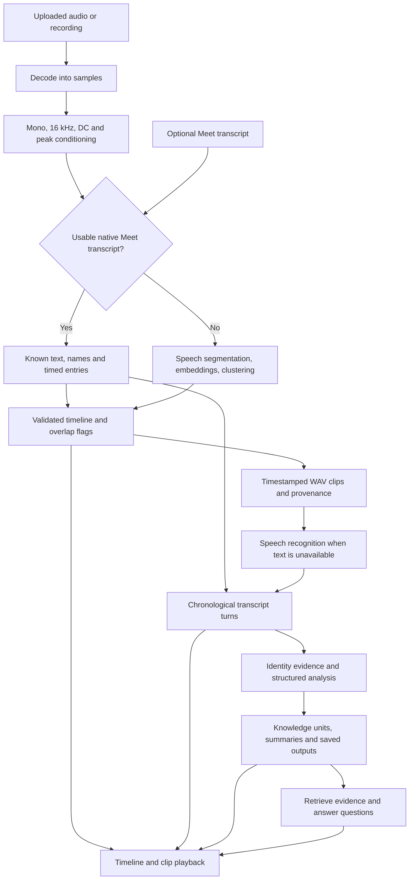

# Minor project: complete explanation, presentation, and demo playbook

Prepared **6 October 2026**. Suggested presentation length: **11–12 minutes**, followed by questions. Replace team-member placeholders with actual names; this guide does not assume a particular team size or college slide template.

Suggested title: **Multi-Speaker Conversation Intelligence: From Meeting Audio to Searchable Insights**.

This guide connects two separately developed areas: the current local DSP demo on `codex/dsp-audio-processing`, and the latest GitHub `AI_Layer` branch at commit `47550b7`. They are **not yet one merged implementation**. The AI architecture was inspected for this documentation task; it was not newly executed or certified here. DSP measurements below come from the existing local validation report.

Detailed references:

- [Actual AI branch architecture and presentation guide](../AI_Layer/07_AI_Layer_Branch_Architecture_and_Presentation.md)
- [Real multi-speaker validation, recordings, results, and reproduction](../DSP/06_Real_Multispeaker_Validation.md)
- [DSP mathematics and physics](../DSP/01_DSP_Mathematics_and_Physics.md)
- [Local demo UI review](../DSP/05_Demo_UI_Review.md)

### How to use this guide

Read sections 1–3 together as a team. Use sections 4–8 to understand the system, section 9 to build slides, and sections 10–12 to rehearse and check readiness. Memorize section 14, then practise the questions in section 13. The full technical explanations belong in speaker notes or viva preparation, not as paragraphs pasted onto slides.

### Contents

- [Project story and opening](#1-the-story-we-want-an-examiner-to-understand)
- [One complete example](#2-one-example-that-explains-the-entire-project)
- [System architecture](#3-whole-system-architecture)
- [Input modes](#4-input-modes-explain-the-shortcut-before-the-algorithms)
- [DSP concepts and implementation](#5-dsp-explained-for-someone-who-has-never-studied-it)
- [AI concepts and implementation](#6-ai-explained-without-pretending-it-is-magic)
- [Engineering contribution](#7-what-is-our-engineering-contribution)
- [Measured results](#8-measured-results-we-can-present-honestly)
- [Twelve-slide presentation plan](#9-presentation-plan-twelve-slides-in-about-eleven-minutes)
- [Demo sequence](#10-a-demo-that-proves-the-right-things)
- [Runbook and checklist](#11-runbook-and-rehearsal-checklist)
- [Integration and future work](#12-what-remains-before-one-unified-demo)
- [Viva questions](#13-viva-questions-and-short-answers)
- [One-minute explanation](#14-one-minute-complete-explanation-to-memorize)
- [Closing script](#15-closing-script)

## 1. The story we want an examiner to understand

### The problem

A recording preserves a conversation, but retrieving information from it still takes effort. To answer “What did we decide?” or “Who said they would do this?”, a user often has to replay audio, interpret several voices, and search a long transcript.

### Our proposed solution

Turn an uploaded conversation into:

1. A timeline showing anonymous speaker groups and when they speak.
2. A readable, time-linked transcript.
3. Inspectable facts, decisions, and action items.
4. A session overview and a structured knowledge representation.
5. Questions answered from conversation evidence rather than an unreferenced paragraph.

### Our scope

The current target is **uploaded Google Meet artifacts and arbitrary audio files**, not microphone localization or an installed physical meeting-room system. No Zoom integration is in scope. Direct Meet OAuth, automatic downloads, and live meeting streaming are future adapters, not completed features.

### Opening script — 30 seconds

> “A meeting recording tells us everything that was said, but it does not immediately tell us what matters. Our project turns a multi-speaker conversation into a speaker timeline, a transcript, structured insights, and evidence-linked answers. DSP handles the sound and speaker timing. AI handles the words and their meaning. We will show the working acoustic demo, explain the AI architecture, and distinguish tested features from remaining integration work.”

Do not open with framework names. Begin with the user's problem, then show the transformation.

## 2. One example that explains the entire project

The following is an **illustrative meeting**, not an actual measured output:

```text
00:02–00:06  Voice A: The upload test is failing on large files.
00:07–00:11  Voice B: Let's use a short WAV recording for our first demo.
00:12–00:15  Voice A: Agreed. I will fix the upload test by Friday.
```

| Representation | What it contains |
|---|---|
| Waveform | Amplitude values changing over time; no words or names yet |
| Speaker timeline | A → B → A, with original times |
| Transcript | The three spoken sentences |
| Fact/state | Large-file upload test is reported as failing |
| Decision | Use a short WAV for the first demo, supported by agreement |
| Task | Voice A commits to fixing the upload test by Friday |
| Source reference | The relevant original turn and time interval |
| User question | “What should be fixed before Friday?” |
| Intended answer | “The upload test,” with the supporting turn |

Notice what we **cannot** infer: Voice A's real name, whether Friday means a particular calendar date without date context, or whether the test really fails outside the conversation. Our system should not silently invent these details.

Use this same example on the architecture slide, the AI slide, and the question-answering slide. A consistent example is easier to follow than a new dataset on every slide.

## 3. Whole-system architecture



This is the **target integrated architecture**. The local DSP application already connects its real acoustic path to its existing AI contract and offline analysis. The latest remote AI branch has a newer six-stage architecture, so a contract adapter and integration verification are still required before claiming this exact diagram as one deployed stack.

Text fallback:

**Input → canonical sound → speaker/time timeline → clips → words → insights → records/summaries → evidence-linked questions.**

### Where each responsibility belongs

| Boundary | Responsibility | Output |
|---|---|---|
| Input adapter | Load files and optional transcript metadata | Canonical session input |
| DSP | Normalize sound, estimate speech/speaker intervals, preserve overlap, clip | Timestamped, labelled audio payload |
| AI transcription | Recognize words or parse existing text | Chronological transcript turns |
| AI analysis | Resolve identity evidence, extract meaning | Source-linked insights |
| Knowledge/storage | Organize records, relationships, summaries, artifacts | Inspectable session/project information |
| Application/UI | Invoke processing and expose outputs | Uploads, timeline, transcript, playback, queries |

The connection should use shared DTOs/protocols. DSP should not import an AI model runtime to decide where a voice changes. AI should not need to know the internal implementation of the diarizer.

## 4. Input modes: explain the shortcut before the algorithms

### A. Uploaded Google Meet artifacts

If a transcript contains usable names, text, and timestamps, prefer it. These are supplied metadata, not names discovered by a voice model. When audio is also available, timestamps can generate playable clips. Transcript-only input can still reach analysis, but cannot play audio that was never uploaded.

The local artifact pipeline has JSON/VTT/text parsing and recording/transcript paths. If there are no usable native timed entries and a recording exists, it can fall back to acoustic processing. **Completing missing portions of a partially valid transcript and integrating that hybrid path with the latest AI branch remain specific follow-up work**, not a demonstrated guarantee.

The latest AI branch's direct transcript parser is different: JSON and speaker/timestamp-prefixed text, not native VTT. Normalize Meet entries at the integration boundary.

### B. Random audio

There is no trusted speaker directory or native timeline. We infer speaker groups acoustically and label them `SPEAKER_00`, `SPEAKER_01`, and so on. These mean “voice groups in this recording,” not real names or persistent identities across recordings.

WAV is the locally tested format. Compressed formats require the decoder adapter and FFmpeg; FFmpeg decoding was not available in the reported workstation runs. Do not promise an MP3-only live demo until that dependency has been tested on the presentation machine.

Say:

> “When Meet already provides a usable timeline, we use it. When we receive a random recording, we estimate the timeline from the sound. Both routes should preserve where the speaker information came from.”

## 5. DSP explained for someone who has never studied it

DSP means performing numerical operations on a sampled signal. Here, the signal is sound: air-pressure changes recorded as amplitude values. We are processing existing speech, **not synthesizing new speech**. Avoid calling this layer “voice synthesis.”

### Step 1 — Decode the file

A WAV loader reads PCM samples and metadata: sample rate, channel count, number of samples, and duration. A compressed recording needs a decoder to recover samples before the same processing can run.

At sample rate `Fs`, sample index `n` represents time:

```text
t = n / Fs
duration = number_of_samples / Fs
```

Visual: a sound wave with five highlighted dots, then a small row of numbers. Caption: **“Sound becomes numbers.”** Do not suggest five dots are enough for actual speech reconstruction.

### Step 2 — Make the input consistent

Our real-model path uses **16,000 samples per second and one channel** because that is the input expected by the selected acoustic models. This is not a claim that 16 kHz preserves every detail of music or full-band audio.

For stereo input, the current conversion averages channels:

```text
mono[n] = (left[n] + right[n]) / 2
```

This is simple and reproducible, but opposite-phase channels can partly cancel. If speakers already have separate channels, preserving channel information could be better; that is not the present downmix behaviour.

When reducing sample rate, an anti-aliasing filter suppresses frequencies that the new rate cannot represent. The real-model path uses polyphase resampling. Its purpose is to avoid high frequencies folding into false lower-frequency content. The dependency-light baseline uses linear interpolation and is not the preferred resampler for real-model validation.

Visual: two channels → one channel; densely spaced samples → 16 kHz samples. Caption: **“Every model receives the same format.”**

### Step 3 — Remove offset and condition volume

We subtract the mean (DC offset), then scale to a safe peak:

```text
x_centered[n] = x[n] - mean(x)
y[n] = 0.95 × x_centered[n] / max(abs(x_centered))
```

Silence/empty input must be handled without division by zero. This recentres the waveform and makes its peak level consistent. It does **not** remove all noise, restore already clipped samples, or equalize each participant independently. Noise can also become louder under peak normalization.

Visual: offset wave → centred wave → scaled wave inside a fixed amplitude box. Caption: **“Conditioning, not magical noise removal.”**

### Step 4 — Voice activity detection: is speech present?

**VAD asks whether speech-like activity is present; it does not identify the speaker or recognize words.**

The local energy-VAD baseline examines short frames: 30 ms windows with a 10 ms hop. At 16 kHz this means 480-sample windows starting every 160 samples. Frames overlap so changes are not inspected only at widely separated instants.

For one frame:

```text
RMS = sqrt(mean(x[n]^2))
level_dBFS = 20 × log10(max(RMS, tiny_positive_value))
threshold = max(-35 dBFS, estimated_noise_floor + 3 dB)
```

The noise floor uses the configured low percentile of frame levels (10th percentile by default). Above-threshold frames are grouped; short activity is rejected and short gaps can be joined. Current baseline settings include 200 ms minimum speech and 250 ms silence-gap handling.

Why this is a **baseline**: a fan, music, or keyboard noise can have high energy. Quiet speech may have low energy. Loudness alone does not establish speech.

**What the real multi-speaker mode does:** energy-VAD intervals are computed, but the learned diarization adapter runs its own speech segmentation on the full conditioned audio. It does not use the energy result as a gate that discards the rest of the recording. This matters because a bad loudness threshold should not remove speech before the neural model can inspect it.

Visual: waveform → small sliding window → activity strip with speech/silence regions. Put a separate label on the neural route: **“Learned speech activity; not just a volume threshold.”**

Say:

> “VAD tells us where speech is likely to exist. Our basic version uses short-frame energy, but the real demo uses learned speech segmentation so it is not dependent only on loudness.”

### Step 5 — Speaker embeddings: describe the voice, not the sentence

The real adapter combines **pyannote segmentation 3.0** with **NeMo TitaNet-small speaker embeddings**, executed locally through **sherpa-onnx** on CPU. These are pretrained models; we did not train them for this project.

A speaker embedding is a vector of numbers describing voice characteristics over a speech region. It is not a person's name, a recognized sentence, or proof of identity. The same person can produce different vectors under noise, emotion, or microphone changes; two people can also sound similar.

Visual: three speech blocks → three vectors → two colour groups. Use symbolic vector values, clearly marked schematic, not invented measured embeddings.

### Step 6 — Clustering: group similar voice descriptions

The selected runtime groups normalized embeddings using cosine-distance, complete-linkage clustering. Intuition: descriptions pointing in similar directions are more likely to belong to one voice group.

```text
cosine_similarity(a, b) = dot(a, b) / (norm(a) × norm(b))
cosine_distance(a, b) = 1 - cosine_similarity(a, b)
```

The current distance threshold is **0.9**, tuned on our small development collection. A higher distance threshold tends to allow more merging; this reduces fragmentation but can merge different voices. A lower threshold can split one person into several labels. It is **not “90% accuracy” or a 90% identity-confidence requirement**.

Automatic clustering is the normal real-demo mode. A known speaker-count override is available, but it must be declared if used. Knowing the count in advance is not the same experiment as discovering it automatically.

Visual: points in two groups → labelled `SPEAKER_00` and `SPEAKER_01`. Label the scatterplot “illustration, not an actual 2-D model output.”

Say:

> “We compare voice embeddings and group similar ones. The output tells us which anonymous voice group spoke when, not which real person owns that voice.”

### Step 7 — Timeline and overlap

Intervals are sorted, validated against audio duration, and assigned stable IDs. Labels follow first-appearance order within the session. Metadata records whether a label came from Meet, diarization, matching, or an unknown source.

If two intervals intersect, both can remain on the timeline and be marked as overlap. We do **not** force the meeting into non-overlapping turns just to make the display simpler.

```text
Original time:  0---------5---------10--------15 seconds
Voice A:       [speech----]        [speech---]
Voice B:             [speech----]
                     ^ overlap ^
```

**Overlap detection is not source separation.** Current overlap clips still contain the original mixed voices. We cannot claim clean recovery of each simultaneous speaker.

The acoustic backend does not provide a calibrated confidence. The local payload stores `0` for unavailable confidence with a warning. Do not show it as “the model is 0% certain” or silently substitute 100%.

### Step 8 — Generate clips without losing time

For interval `[start, end)`, we slice samples using the original session clock:

```text
start_index ≈ round(start × Fs)
end_index   ≈ round(end × Fs)
clip        = audio[start_index:end_index]
```

Each WAV clip retains its segment ID, speaker label, original interval, source, overlap state, and path. These clips are the handoff to speech recognition. Eight clips can become fewer readable turns after stitching; clip count and turn count need not match.

Visual: one long waveform → three cropped WAV cards, with original timestamps above each. Caption: **“A clip starting at zero still belongs to its original meeting interval.”**

### Supporting concept — spectrograms

A waveform shows amplitude versus time. A spectrogram shows energy across frequency and time. The local project includes an STFT analysis helper, useful for explanations and diagnostics:

```text
Short waveform windows → apply a window function → Fourier transform
                      → stack frequency magnitudes across time
```

A window such as Hann softens the edges of each short slice to reduce spectral leakage. This visualization helps explain speech structure, but a plotted spectrogram by itself is not the implemented speaker recognizer. Do not claim manual MFCC matching or NMF separation runs just because they appear in a theory diagram.

## 6. AI explained without pretending it is magic

### A. Speech-to-text

STT recognizes words. In the current real local DSP demo, a quantized **Whisper tiny English** model runs offline. The clip's speaker/time metadata survives transcription. Longer clips are processed in bounded windows so later audio is not silently discarded.

The latest AI branch uses its own replaceable provider interface with local Whisper/Faster-Whisper and optional cloud STT adapters. These are different implementation paths. Neither the model name nor a good-looking transcript guarantees correct words. Current times are segment/turn times, not independently verified word-level alignment.

### B. Name resolution

The newer AI branch can inspect names and conversation cues with known profiles. Acoustic voice groups are not automatically real identities. Self-introduction, addressing someone, and third-party mentions require different interpretation. Unknown participants should remain unknown.

### C. Structured interpretation

Separate three questions:

- **Fact/state:** what was reported?
- **Decision:** what was actually agreed?
- **Action:** what work was committed or assigned, to whom, and by when?

AI outputs should link back to source turns. An informal podcast-style conversation can legitimately contain no tasks. We should not manufacture a deadline to make the action-item panel look impressive.

### D. Knowledge and summaries

The newest AI design uses content units, relationship edges, and audit logs; it distinguishes session summaries from project summaries. The current web execution uses a fresh in-memory database plus per-session JSON outputs. A disk archive is useful, but it is not automatically durable cross-session semantic memory.

### E. Evidence-linked questions

Retrieval first finds relevant conversation snippets. Answer generation then uses those snippets and exposes references, or returns a not-found response. The current AI branch retrieves with in-memory/lexical ranking, not an already deployed pgvector service.

Current citation linking has fallback risks documented in the companion guide. Inspect the quoted/source text instead of asserting that any citation proves factual correctness.

### Offline demo versus live language-model inference

The **local real acoustic demo** uses real neural diarization and real local STT, followed by **offline deterministic/extractive analysis**. It is not a live cloud-LLM reasoning demonstration.

The newest AI branch's mock provider has fixed example outputs that may be unrelated to arbitrary input. It can test contracts, but must not be presented as automatic accurate analysis of the real recording. Use a verified real-provider result for semantic claims, or clearly label a mock fixture.

## 7. What is our engineering contribution?

Do not claim we invented Whisper, pyannote, TitaNet, the Fourier transform, or pretrained language models.

Our contribution is the **system and its verification**:

- A consistent input/normalization path and native-transcript option.
- Provider boundaries that distinguish mock, baseline, and real inference.
- A multi-speaker timeline with anonymous labels and overlap metadata.
- Timestamp-preserving clip generation and DSP-to-AI contracts.
- A structured analysis/knowledge/query architecture implemented by the AI branch.
- A UI that makes audio, labels, words, and evidence inspectable.
- Reproducible testing, benchmark scoring, stress probes, and honest failure reporting.

Suggested wording:

> “This is an integration and evaluation project using pretrained models. Our work is making the stages interoperable, preserving evidence across them, and demonstrating where the system succeeds and fails.”

## 8. Measured results we can present honestly

These are **previously recorded local DSP results**, not fresh measurements from this documentation task or results of the newest AI branch.

| Experiment | Result | What it proves / does not prove |
|---|---|---|
| Annotated 30-second two-speaker meeting | 5.99% zero-collar DER, overlap included | Timing/attribution on one labelled development recording |
| One-speaker energy-VAD fallback on the same reference | 49.57% zero-collar DER | Same-recording baseline comparison |
| Three publisher-labelled English samples | Two labels returned for each | Count/clip checks; no full attribution or WER reference |
| Publisher-labelled 56.861-second Chinese sample | Four labels automatically returned | Diarization count; not English-STT multilingual validation |
| Quiet, PCM-quantized annotated meeting | 9.65% DER | Derived low-amplitude stress probe |
| Annotated meeting with seeded 15 dB Gaussian noise | 10.14% DER | Derived noise stress probe |
| Annotated meeting converted to 48 kHz stereo | 6.13% DER after normalization | Format/resampling stress probe |
| Four-speaker recording repeated four times | 227.443 s; four labels; 63.27 s processing on one run | Synthetic length stress, not an independent long meeting |
| Real 54.805-second English UI demo | Two labels, eight WAV clips, five stitched real-STT turns | Local acoustic → STT → existing contract → UI/storage path |
| Local regression suite | 103 passed, one optional real test skipped by default; opt-in test separately passed | Local branch tests, not the new AI branch test count |

### Explain DER before showing the number

```text
DER = (missed speech + false-alarm speech + wrong-speaker speech)
      / reference speaker-time
```

Speaker-time includes both speakers during overlap. Anonymous label names are arbitrary, so scoring finds the best correspondence between predicted and reference labels.

The reported main result uses **no boundary collar**: boundary errors count. A separate ±250 ms exclusion produced 0% on this small example, but excluded 8.01 reference speaker-seconds. **Do not use 0% as the headline or say recognition is perfect.**

The threshold was tuned on these examples, so they are development results, not a held-out generalization study. DER is not word error rate, and `100 - DER` should not be advertised as an overall system accuracy.

Suggested results narration:

> “On one annotated two-speaker development recording, our local multi-speaker mode reduced diarization error from 49.57 percent for the one-speaker fallback to 5.99 percent. We also tested quieter audio, added noise, format conversion, and a repeated longer input. This is promising prototype evidence, not a claim of the same accuracy on every meeting.”

## 9. Presentation plan: twelve slides in about eleven minutes

Use a plain educational style: light background, readable type, consistent colour per speaker, and one central diagram per technical slide. Avoid decorative dashboards in place of evidence. Reveal stages progressively; animations should explain a transformation, not delay the talk. A moving cursor through the timeline is more useful than particles or glowing boxes.

| Slide | Time | Put on the slide | What to say / show |
|---|---:|---|---|
| 1. Title and objective | 0:30 | Audio → timeline → insights → question | Opening script; name the scope |
| 2. Why recordings are hard to use | 0:45 | One question beside a long audio bar | “A recording is complete but not immediately searchable knowledge.” |
| 3. Two input modes | 0:45 | Meet artifacts vs random audio converging | Explain native metadata versus inferred anonymous labels |
| 4. Architecture and boundaries | 1:00 | Six large blocks, not every class | Sound → time/voice → words → meaning → records → answers; disclose branch boundary |
| 5. DSP: format and speech activity | 1:15 | Sample dots, resampling, sliding frame, activity strip | Decode, 16 kHz mono, conditioning, baseline versus learned VAD |
| 6. DSP: which voice and when? | 0:45 | Embedding groups and two timeline lanes | Clustering, anonymous labels, overlap is not separation |
| 7. AI: turns into insights | 1:00 | The same three example turns and three cards | STT, identity evidence, fact/decision/task; avoid fabricated commitments |
| 8. Records, summaries, questions | 0:45 | Evidence card → answer, plus old/new knowledge edge | Retrieval and provenance; clarify current storage scope |
| 9. Live demo | 2:00 | Application, not a screenshot-heavy slide | Run/open real recording; play two voices; inspect transcript/provider/session |
| 10. Evaluation | 1:00 | 49.57% vs 5.99% DER bars, small robustness table | Explain reference, small development set, no WER claim |
| 11. Limitations and remaining work | 0:45 | Three current limits; three next steps | Integration, overlap quality, larger independent evaluation |
| 12. Conclusion and contributions | 0:45 | Original pipeline, now with visible artifacts | What works, each member's real contribution, final takeaway |

Total: **11 minutes 15 seconds**, leaving a small buffer. If only eight minutes are allowed, combine slides 2–3 and 7–8, shorten the live demo to 90 seconds, and keep the evaluation and limitations.

### Suggested team handoffs

- **Problem/architecture presenter:** introduce the common example and boundaries.
- **DSP presenter (your section):** show sound → speech activity → voice groups → clips; explain the two VAD modes and evaluation.
- **AI presenter:** explain actual six-stage architecture, evidence and provider distinctions.
- **Application/testing presenter:** demonstrate the interface, reproduce results, and state remaining integration work.

Assign names according to actual contributions. If one person covers multiple roles, keep the handoff sentences, not artificial team divisions.

DSP → AI handoff:

> “We now have labelled clips with their original meeting times. Speech recognition turns each clip into words, and the next layer interprets those words.”

AI → demo handoff:

> “The architecture is useful only if its outputs can be inspected. We will now show the actual recording, the speaker timeline, the recognized words, and the selected provider mode.”

## 10. A demo that proves the right things

### Main demonstration: real acoustic multi-speaker processing

Use the downloaded **54.805-second English conversation**, available through the local application's **Real conversation demo**. It is a publisher-hosted test conversation, not a podcast we independently labelled. Source URLs and hashes are recorded in `configs/diarization_assets.json` and the validation report.

Demo sequence:

1. Explain the file, its duration, and that real local speaker detection is selected.
2. Start processing, or open the previously verified run if the room cannot wait. Say which it is.
3. Show the two anonymous speaker lanes. Explain automatic grouping, not name recognition.
4. Play one clip from each lane. Let the audience hear the difference.
5. Show the real-STT transcript and original timestamps. Mention a visible recognition error if one exists.
6. Show provider labels, session ID, clips, and saved transcript/overview.
7. If demonstrating a question, use an already verified question about the transcript and show its source references. The prior local endpoint test for “What is generative AI?” returned three evidence citations; rehearse the actual UI path separately.

Previously inspected local run: `sess_20261006_032624_214626`, about 36.47 seconds overall. The runtime varies by CPU load and model initialization; do not promise a fixed response time.

Narration:

> “These colours represent voice groups detected from actual audio. The words are produced by a local speech recognizer. The downstream overview uses offline extractive analysis in this demonstration; we are not showing a cloud LLM call.”

### Second demonstration: decisions and tasks, only if verified

The real example discusses a topic and has no clear commitments, so zero action items is a reasonable result. To demonstrate tasks, use a separately labelled timestamped meeting fixture containing explicit commitments, or a real recording whose transcript and provider output have been reviewed.

If using the latest AI branch with its mock provider, say:

> “This is a controlled fixture demonstrating the contracts and interface, not measured semantic extraction on the downloaded recording.”

Prefer a clear pair of demos—**real acoustics** and **controlled analysis**—to pretending one arbitrary conversation proves every output category.

Do not improvise an untested latest-branch UI demonstration: its missing helper files need restoration and a clean build first. The existing local DSP web application is a different, previously inspected application.

## 11. Runbook and rehearsal checklist

### Local DSP demo, from this repository root

Use the tested Python 3.12 environment and install dependencies/download assets **before** the presentation:

```powershell
python -m pip install -r requirements.txt -r requirements-diarization.txt
python scripts/setup_diarization.py --with-stt --samples
python app.py --port 5092
```

Open `http://127.0.0.1:5092/`. This is a local address, not a deployed public service. If an existing process already uses the port, identify it or select another free port; do not start a second server and assume it replaced the first.

Optional CLI processing:

```powershell
python cli.py ingest recording.wav --mode mock --dsp-provider local_model
```

Here `--mode mock` selects offline analysis while `local_model` selects **real diarization and real local STT**. Explain both selections. Use `--num-speakers` only if the count is genuinely known and declare that override.

### Latest AI branch: separate preparation, not a checkout instruction

Do not switch this dirty DSP working directory to another branch for the presentation. Prepare the actual AI branch in a separate clean copy with its own dependencies. After fixing its missing frontend helpers:

```powershell
# In the clean AI_Layer copy, with its dependencies installed:
$env:LLM_PROVIDER = 'mock'
$env:STT_PROVIDER = 'mock'
python backend/run.py

# In a second terminal, inside that copy's frontend folder:
npm ci
npm run build
npm run dev
```

Backend defaults to port 8005 and API docs `/api/docs`; the frontend development script normally uses Next.js's default port. Verify the restored API client's base URL and CORS configuration. Treat the commands as preparation, **not confirmation that the checked-in frontend currently builds**.

For genuine local STT on CPU, inspect both typed config and the HTTP service's provider overrides. Do not assume an environment variable alone wins over device settings reconstructed from the YAML by the web service.

### Before entering the presentation room

- [ ] Models and sample WAVs exist locally; no first-run downloads are needed.
- [ ] All model/sample licenses and source acknowledgments are available.
- [ ] The demo starts without credentials for the offline path.
- [ ] The chosen port, browser, sound output, and two clip-playback buttons work.
- [ ] You can explain real, mock, baseline, and native-transcript modes.
- [ ] A completed real session and screenshots are ready as a labelled fallback.
- [ ] You know which transcript words are wrong and do not hide them.
- [ ] Any claimed action/decision is present in its source turn.
- [ ] Results slide says development data and zero-collar DER.
- [ ] Remote AI missing files/build and adapter integration are not presented as completed.
- [ ] No API key, private meeting, or personal information is visible on screen.
- [ ] Everyone can deliver the 30-second project explanation without reading.

### If something fails during the demo

| Situation | Response |
|---|---|
| Model assets missing | Explain the dependency; use saved real outputs labelled as an earlier run |
| CPU processing takes longer | Explain model loading and batch processing; continue with architecture, then return |
| Audio will not play | Check system sound; use the verified transcript/timeline; do not pretend playback worked |
| MP3 upload cannot decode | Use the tested WAV and explain FFmpeg dependency |
| More speaker labels than expected | Explain fragmentation/threshold trade-off; do not covertly supply the desired count |
| No action items | Explain that the conversation contains no explicit commitments |
| A word is wrong | Replay the source and state STT uncertainty; this is why evidence is retained |
| AI UI displays demo data | Label it fixture mode; show a fresh backend session or saved real artifacts |
| Latest AI frontend does not build | Use its API/JSON evidence after verification; do not rely on missing helpers |
| No answer to a question | A supported not-found response is preferable to an invented answer |

Saved-output playback is a valid fallback if honestly labelled. It is not a live processing run.

## 12. What remains before one unified demo?

### Necessary integration work

1. Freeze a versioned shared DSP-to-AI contract and adapt local payload segments to the latest AI `AudioClip` model.
2. Preserve source type, speaker provenance, overlap, warnings, confidence availability, and original timestamps across that adapter.
3. Replace the newest AI raw-file placeholder interval with measured timelines or consume DSP clips directly.
4. Add a native-transcript handoff that actually bypasses STT, and separately test partial-transcript gap filling.
5. Restore the AI frontend's missing `lib` files, pass a clean build, and point one UI at the integrated backend.
6. Verify the latest AI flow on DSP-generated clips using mocks, then real inference, with exact source checks.
7. Make storage lifetime explicit; implement durable reload/reuse if claiming cross-session memory.
8. Fix weak citation fallback and label uncertainty instead of assigning an unrelated source.

These are distinct from the already demonstrated local real-acoustic path. Do not reset or replace either branch blindly to combine them.

### Improvements after the minor-project MVP

- Evaluate new, independently annotated recordings that were not used to tune the clustering threshold.
- Score transcription against reviewed references using WER; measure extraction and citation correctness separately.
- Improve short interjections, similar voices, stronger noise, and multilingual input.
- Investigate actual overlap source separation and verify whether it improves downstream recognition.
- Add opt-in registered voice matching with consent and unknown-speaker rejection.
- Integrate uploaded Meet artifacts into the final UI, then consider direct OAuth/download adapters.
- Add access control, safe upload/path handling, resource limits, retention/deletion policy, and deployment hardening.
- Consider live streaming only after batch boundaries, latency, and incremental speaker behaviour are tested.

MFCC matching, NMF separation, a Nemotron integration guide, and a database schema are **not proof those features run**. Present them as options unless connected and verified.

## 13. Viva questions and short answers

**1. What is the difference between VAD, diarization, identification, and STT?** VAD detects speech activity. Diarization groups voices over time. Identification associates a voice or label with a known person. STT recognizes words. They solve different problems.

**2. Why 16 kHz?** It matches the selected models' input and represents frequencies below its 8 kHz Nyquist limit; it is not a universal ideal audio format.

**3. Why anti-aliasing?** Downsampling without suppressing high frequencies can fold them into incorrect low-frequency content.

**4. Does normalization remove noise?** No. It centres and scales the signal. It can amplify noise as well as speech.

**5. Does energy VAD work on all noise?** No. Loud non-speech can pass its threshold. The real path uses learned segmentation rather than only energy gating.

**6. How are speakers separated?** We separate their labels and time intervals through embeddings and clustering. We do not currently isolate simultaneous voices into clean audio sources.

**7. Does a speaker label mean a name?** No. Anonymous acoustic labels are session-local. Names require trusted metadata or explicit, reviewable identity evidence.

**8. Is a threshold of 0.9 a 90% confidence?** No. It is a clustering distance setting with a merge/fragmentation trade-off.

**9. Did you train the models?** No. We use pretrained models and build/evaluate the system around them.

**10. How did you measure quality?** A locally tested interval scorer measured zero-collar DER on one annotated recording with overlap. Other files provided counts and integrity checks, not full accuracy measurements.

**11. What does five turns from eight clips mean?** Adjacent clips from one speaker can be stitched into a readable turn while preserving source IDs.

**12. Why not just use Google Meet's transcript?** We prefer it when supplied and usable. Random recordings and missing artifacts still need an acoustic path. Direct Meet API access is not the present upload MVP.

**13. Is the entire system offline?** The current real acoustic demo and offline analysis run locally after asset setup. Optional cloud AI providers send data externally; they require separate configuration and consent.

**14. Can the AI hallucinate?** Yes. Structured outputs, retrieval, citations, and not-found behaviour help inspection but do not eliminate errors. Some current citation/mock behaviour needs improvement.

**15. Is PostgreSQL/pgvector already powering the newest AI UI?** No. Its current pipeline service uses an in-memory mock store and JSON session artifacts. A schema or embedding field is not a deployed vector database.

**16. Can it handle any number of speakers?** We demonstrated two- and four-speaker recordings; we have not established a universal capacity or reliable large-meeting limit.

**17. What about privacy?** Local acoustic inference avoids cloud calls in the current demo, but stored recordings/transcripts still need consent, access control, and retention rules. Cloud provider modes have different data handling.

**18. What is the most important remaining step?** A verified adapter to the latest AI architecture, then exact provenance checks and a larger independent evaluation—not simply more UI decoration.

## 14. One-minute complete explanation to memorize

> “Our project converts an uploaded multi-speaker conversation into information that can be inspected and searched. First, we decode and normalize the audio into the format our acoustic models expect. We detect speech and group voice embeddings to estimate who spoke when, using anonymous labels unless trusted names are supplied. We preserve overlapping intervals and cut timestamped clips; overlap detection does not yet mean clean source separation. A local speech recognizer produces the words. The AI architecture then resolves identity evidence, extracts facts, decisions, and tasks, organizes knowledge, and generates summaries. Questions should be answered from retrieved conversation evidence with source references. We have demonstrated the real local acoustic pipeline and measured diarization on a small development set. The latest AI branch is a newer implementation, and joining it through a shared contract is remaining work. Our contribution is the interoperable pipeline, inspectable outputs, and evaluation—not training the pretrained models.”

## 15. Closing script

> “The key result is not just a transcript. It is a path from sound to voice groups, from voice groups to words, and from words to inspectable knowledge. Our prototype demonstrates real multi-speaker processing and exposes its outputs. The next priorities are verified integration with the latest AI branch, stronger provenance, and independent evaluation on more varied conversations.”

This guide is a presentation blueprint, not a claim that the slide deck or unfinished integration has been built. The earlier local beginner explainer remains unchanged; these new guides are separate Markdown documents.
